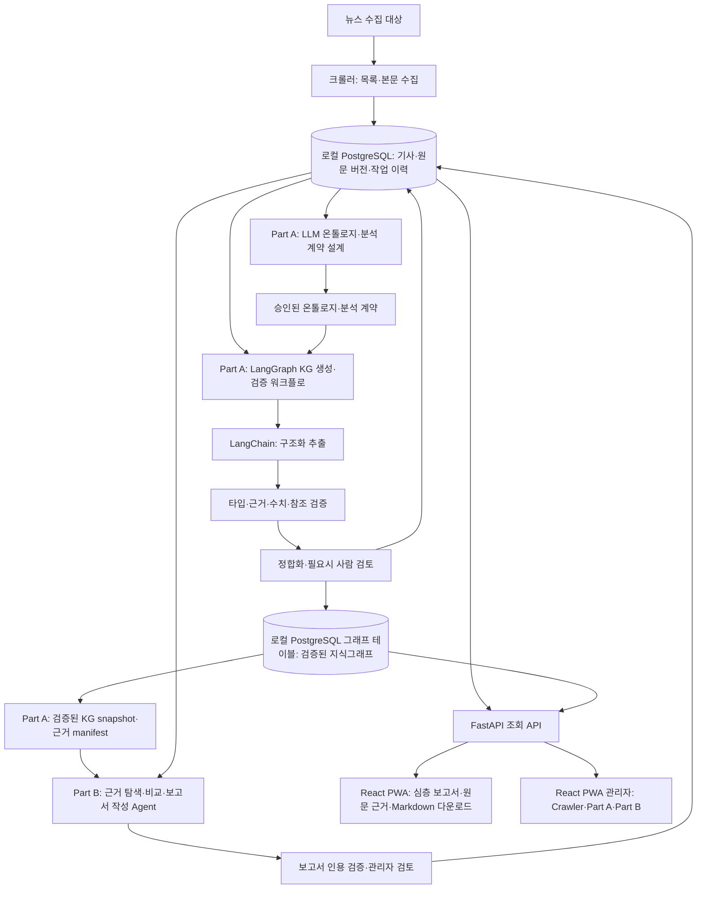

# NewsContext 프로젝트 기획서

경제뉴스의 이슈·사건·기업·업종·보도된 시장 반응을 구조화하고, 시간 흐름과 관계를 분석하여 원문 근거를 추적할 수 있는 **심층 리서치 보고서**를 작성하는 AI Agent 시스템입니다. 현재는 구현 전 설계 단계입니다.

> 작성일: 2026-11-13 · 상태: 구현 전 기획안. 아래 폴더·스키마·API·일정은 구현 계획이며, 기술 버전과 성능은 개발 과정에서 검증합니다.

## 1. 목적과 범위

기사 단위 검색에서 한 걸음 나아가 “어떤 기관이 언제 무엇을 했으며, 어느 기사가 이를 뒷받침하는가?”를 확인할 수 있도록 합니다. 원문 저장과 지식그래프(노드·관계 테이블) 모두 로컬 PostgreSQL이 담당하고 LangChain과 LangGraph를 이용해 추출·검증·재처리 흐름을 구성합니다.

최종 산출물은 **이슈 하나·분석 기간 하나에 대한 근거 기반 심층 리서치 보고서**입니다. KG·검색·타임라인은 보고서 작성과 검증을 지원합니다. MVP는 로컬 Agent가 보고서를 생성하고 관리자가 검토·공개한 뒤 PWA에서 열람·Markdown 다운로드하도록 합니다. PDF는 후속 확장입니다. 구성·생성 흐름·공개 기준은 [리서치 보고서 출력 설계](docs/report-output.md)를 기준으로 합니다.

주요 사용자는 경제 뉴스를 조사하는 학습자와 리서치 담당자입니다. MVP는 개발자 로컬 환경의 본체(수집·Part A·Part B·관리자 조작)를 먼저 구현합니다. 포트폴리오용 공개 조회 데모는 **향후 구현**이며 `.env`를 `public_demo`로 설정하는 시점부터 착수합니다(2026-11-13 사용자 결정).

**저장소 기준(2026-11-17 정리):** 정본(source of truth)은 **로컬 PostgreSQL**(원문·버전·작업 이력·체크포인트·지식그래프)과 로컬 파일 archive입니다. **별도 그래프 DB(Neo4j)는 MVP에서 쓰지 않습니다**(2026-11-17 결정, [그래프 저장 방침](#그래프-저장-방침-postgresql-테이블-2026-11-17-결정)). Supabase·Render는 공개 데모용 export 대상으로만 쓰며 MVP 범위가 아닙니다. 이 문서와 하위 문서에서 Supabase·Render를 언급하는 절은 별도 표기가 없어도 `public_demo`(향후) 설계 메모로 읽습니다. 하위 문서에 남은 Neo4j·Aura·Cypher 언급은 이 결정 이전의 설계이며, MVP에서는 PostgreSQL 그래프 테이블과 고정 SQL 조회로 읽습니다.

대상 corpus는 네이버의 매일경제·서울경제·한국경제 **2년치 뉴스**를 후보로 검토합니다. 정확한 기간·섹션·실제 접근 가능성·전체 기사량은 표본으로 먼저 확인합니다. 임베딩은 선행 필수 기능이 아니라 **임베딩 없는 KG·보고서의 성과와 검색 누락을 측정한 뒤** 도입 여부를 결정합니다. 2년 전량의 무료 DB 적재는 보장하지 않으며 선별된 활성 분석 집합으로 MVP를 시작합니다. 저장 구조는 **로컬 본체(전량 원문·전체 파이프라인) / 공개 데모(선별 이슈·링크·요약·근거만)로 분리**하기로 확정했습니다(세부 항목은 미결). 수집량·용량·시간의 가정과 실험 단계, 분리안은 [corpus 타당성 검토](docs/corpus-feasibility.md)에 정리했습니다.

| 구분 | MVP 범위 | 후속 확장 |
|---|---|---|
| 수집 | 지정 언론사·날짜·페이지 범위의 뉴스 수집 | 정기 수집, 추가 매체·공식 데이터 연동 |
| 주제 | 경제 이슈·관련 기업/업종·기사에 보도된 시장 반응 | 주제별 추출 범위 확대 |
| 저장 | 기사 원문·수정 버전·처리 이력 보존 | 장기 보관 정책, 대량 처리 |
| 지식그래프 | 이슈·기관·기업·업종·사건·시장 반응 주장·원문 근거 연결 | 시간·규칙·다중 경로 분석 고도화 |
| 조회 | 기사 검색·사건 타임라인·전후 맥락·보도된 인과 설명 | 규칙 추론·관계 후보·그래프 근거 요약 |
| 최종 산출물 | 출처가 연결된 심층 보고서·PWA 열람·Markdown 다운로드 | PDF·보고서 비교·주기적 갱신 |

기사만으로 실제 인과효과나 투자 판단을 확정하지 않습니다. 기사에 없는 날짜·의도·관계는 추측해 채우지 않으며, 불명확한 값은 미확정으로 남깁니다.

분석 개념은 **Temporal Analysis / Context Awareness / Logical Reasoning / Knowledge Discovery / Causal Relation Analysis / Causal Inference**의 여섯 축으로 정의합니다. 앞의 다섯 축은 뉴스 기반 분석의 구현 범위로 단계적으로 접근하고, Causal Inference는 별도 관측·개입 데이터와 식별 가정이 필요한 후속 연구로 둡니다. 구현 방법·근거 수준·평가 기준은 [연구 접근과 분석 개념](docs/research-approach.md)에 정리했습니다. Temporal Analysis는 우선 뉴스 사건의 시간 변화이며 수치 시계열 예측을 뜻하지 않습니다.

### 핵심 사용자 시나리오

1. 운영자가 언론사와 수집 기간을 지정하면 기사가 저장되고 수집 결과를 확인합니다.
2. Part A에서 LLM과 표본 기사를 활용해 온톨로지·분석 계약을 설계·검증·승인합니다.
3. Part A가 기사에서 이슈·대상·사건·보도 반응·근거를 추출하고 검증·정합화·KG 적재를 완료하여 ready snapshot을 발행합니다.
4. 관리자가 연구 질문·대상·기간·정보 기준 시점을 지정하면 Part B의 Agent가 근거를 탐색·비교하고 보고서를 작성합니다.
5. 보고서의 인용·주장·상충 정보·한계를 검증하고 관리자 검토 후 공개합니다. 사용자는 PWA에서 보고서와 원문 근거를 확인하고 Markdown을 내려받습니다.
6. 실패한 작업은 실패 단계에서 재개하고, 수정된 기사·분석 설정은 새 보고서 버전으로 처리합니다.

## 2. 전체 구성

프로젝트의 업무 프로세스는 **Crawler → Part A → Part B의 3단계**로 정의합니다. DB·API·관리자 화면·평가는 이 3단계를 지원하는 공통 기능입니다.

| 단계 | 목적 | 함수 파이프라인 | 산출물·다음 단계 진입 조건 |
|---|---|---|---|
| 1. Crawler | 뉴스 원문 수집·정제·버전 저장 | 범위 검증 → 목록 수집 → 본문 파싱 → 정규화 → 버전 저장 | 로컬 PostgreSQL 원문 버전·수집 이력 |
| 2. Part A | LLM 기반 온톨로지 설계·KG 구축·검증 | 질문/분석 계약 → 온톨로지 후보·승인 → 기사 추출 → 근거 검증 → 정합화 → KG 적재 → manifest 확정 | 승인 분석 계약·온톨로지·검증된 KG·ready snapshot |
| 3. Part B | Part A KG 기반 심층 보고서 작성 | 계약·snapshot·개별 질문 확인 → 근거 탐색·비교 → 분석 → 작성 → 인용 검증 → 검토·공개 | 근거 기반 심층 보고서·Markdown·실행 이력 |

Part A는 **LLM을 활용해 온톨로지를 설계하고 실제 지식그래프까지 구축·검증**합니다. Part B는 그 지식 기반을 읽어 **심층 리서치 보고서**를 작성합니다. A→B 인계는 `analysis_contract_version`·`ontology_version`·`kg_snapshot_id`와 원문/근거 manifest로 고정합니다. KG snapshot은 그래프 DB 물리 백업이 아니라 사용할 원문·주장·근거·적재 버전을 고정한 논리 manifest입니다. 상세 책임·함수·검증·재작업 설계는 [Part A 기획·설계](docs/part-a-planning.md)를 따릅니다.

Part A의 온톨로지/분석 계약은 재사용하고 새 기사는 승인 계약으로 KG에 추가합니다. Part B가 KG의 근거 부족이나 스키마 미지원을 발견하면 Part A에 보완 요청을 남기며 KG를 자동 수정하지 않습니다. 보완된 새 snapshot으로 Part B의 새 보고서 작업을 시작합니다. 온톨로지 승인·추출 주장 검토는 Part A에서, 보고서 승인·공개는 Part B에서 각각 관리합니다. 전문 에이전트의 문서 검토 작업은 개발 협업 방식이며 실행 앱의 전문가 검색·카탈로그·팀 편성 기능은 범위에 포함하지 않습니다.



LangChain은 모델·도구 연결 및 구조화 추출에, LangGraph는 상태와 조건 분기·중단·재개 흐름에 사용합니다. LangGraph의 실행 그래프와 PostgreSQL 그래프 테이블에 저장하는 뉴스 지식그래프는 별도 구성 요소입니다. 역할 구분은 [LangChain 공식 개요](https://docs.langchain.com/oss/python/langchain/overview)와 [LangGraph 공식 개요](https://docs.langchain.com/oss/python/langgraph/overview)를 참고했습니다.

## 3. 폴더 구조

다음은 구현할 목표 구조입니다. 현재는 기획서만 작성된 상태입니다.

```text
NewsContext/
├─ README.md                       # 프로젝트 기획 및 개발 안내
├─ pyproject.toml                  # 의존성·실행·검사 설정
├─ .env.example                    # 비밀값 없는 환경변수 예시
├─ .gitignore
├─ .github/workflows/ci.yml         # PR·main 검증, 구현 단계에서 생성
├─ Dockerfile                      # React 빌드 + 공개 FastAPI 이미지, 구현 예정
├─ .dockerignore                   # 비밀값·dump·로컬 데이터 빌드 제외, 구현 예정
├─ scripts/                        # 정기 dump·복원·복원 검증 실행 스크립트
├─ configs/
│  ├─ sources.yaml                 # 언론사·요청 간격·페이지 제한
│  ├─ pipeline.yaml                # 재시도·토큰·시간 예산
│  ├─ analysis_contracts/v1.yaml    # Part A 분석·보고서·근거·평가 계약
│  ├─ references.yaml              # 논문·저장소·commit·재사용 범위·실험 추적, 구현 예정
│  ├─ retrieval.yaml               # lexical/graph/embedding 검색 정책·profile, 구현 예정
│  └─ ontology/v1.yaml             # 타입·관계·단위·필수 근거 계약
├─ prompts/
│  ├─ extraction_v1.md             # Part A 추출 프롬프트
│  └─ report_v1.md                 # Part B 보고서 작성 프롬프트
├─ src/newscontext/
│  ├─ config.py                    # 환경변수 로딩 및 설정 검증
│  ├─ cli.py                       # 초기화·수집·추출·재처리 명령
│  ├─ db/
│  │  ├─ connection.py             # PostgreSQL 연결·트랜잭션(local_admin: 로컬 DB)
│  │  ├─ repositories.py           # 기사·버전·작업 저장 및 조회
│  │  ├─ integrity.py              # FK 없는 논리 참조 검사·삭제 제한
│  │  └─ migrations/               # 데이터 보존형 순차 마이그레이션(그래프 노드·관계·membership 테이블 포함)
│  ├─ crawler/
│  │  ├─ client.py                 # 요청 간격·타임아웃·오류 처리
│  │  ├─ naver.py                  # 목록·본문·발행 시각 파싱
│  │  ├─ normalize.py              # URL·본문 정규화 및 해시
│  │  └─ service.py                # 수집 범위·중복·재수집 제어
│  ├─ ontology/
│  │  ├─ design.py                 # Part A: 업무 질문·스키마 후보 생성
│  │  ├─ approval.py               # Part A: 검증·승인·버전 발행
│  │  ├─ reset.py                  # 개발용 Part A 삭제·초기화·재생성
│  │  ├─ contracts.py              # Pydantic 출력 모델
│  │  ├─ validators.py             # 타입·근거·단위·ID 검사
│  │  └─ canonicalization.py       # 기관 별칭·전역 ID 정합화
│  ├─ analysis/
│  │  ├─ contracts.py              # analysis_contract_version·ontology 연결
│  │  ├─ validation.py             # 질문·근거·보고서 목차·평가 계약 검증
│  │  └─ snapshots.py              # Part A ready KG manifest 생성·상태·영향
│  ├─ extraction/
│  │  ├─ model.py                  # LangChain 모델 연결
│  │  └─ extractor.py              # 문단 분할·구조화 추출
│  ├─ retrieval/
│  │  ├─ embeddings.py             # 선택 embedding adapter·profile·차원 검증
│  │  ├─ repository.py             # FK 없는 명시적 pgvector SQL·버전별 저장
│  │  └─ hybrid.py                 # 키워드·그래프·벡터 후보 결합·snapshot 필터
│  ├─ workflows/
│  │  ├─ state.py                  # 입력·후보·오류·버전·예산 상태
│  │  ├─ nodes.py                  # 업무 함수를 호출하는 얇은 노드 함수
│  │  ├─ graph.py                  # StateGraph 조립·분기·검토·재개
│  │  └─ checkpoints.py            # 영속 체크포인트 설정
│  ├─ graph/
│  │  ├─ writer.py                 # PostgreSQL 그래프 테이블 멱등 적재·주장 상태 갱신
│  │  └─ queries.py                # 매개변수 고정 SQL 조회(hop·행 수 상한, snapshot 필터)
│  ├─ research/
│  │  ├─ contracts.py              # 연구 질문·보고서·필드별 인용 계약
│  │  ├─ tools.py                  # 기간·경로·기사·근거 조회 도구
│  │  ├─ agent.py                  # 제한된 계획·도구 선택·근거 보완
│  │  ├─ writer.py                 # 구조화 보고서·Markdown 생성
│  │  └─ validators.py             # 인용·주장 수준·시간 범위 검증
│  └─ api/
│     ├─ main.py                   # FastAPI 앱·상태 확인
│     ├─ schemas.py                # 요청·응답 계약
│     └─ routes/                   # 인증·기사·사건·작업·검토 API
├─ frontend/                       # React·TypeScript 기반 단일 PWA
│  ├─ package.json                # 프런트엔드 의존성·빌드 명령
│  ├─ package-lock.json           # 검증된 npm 의존성 고정
│  ├─ vite.config.ts              # 개발 서버·/api 프록시·PWA 빌드 설정
│  ├─ public/icons/               # 설치 아이콘·maskable 아이콘
│  ├─ src/
│  │  ├─ main.tsx                 # React 진입점
│  │  ├─ app/                     # 라우터·레이아웃·권한·연결 상태
│  │  ├─ pages/                   # 기사 검색·사건·근거 상세
│  │  ├─ admin/                   # Crawler·Part A·Part B·운영 현황
│  │  ├─ components/              # 표·폼·타임라인·후보 비교
│  │  ├─ api/                     # 타입화된 API 호출·상태 조회
│  │  └─ pwa/                     # Service Worker·오프라인·업데이트 안내
│  └─ tests/                      # 화면·캐시·인증·PWA 동작 검증
├─ tests/
│  ├─ fixtures/                    # 고정 HTML·기사·모델 응답
│  ├─ unit/                        # 파서·근거·단위·정합화 검증
│  ├─ integration/                 # DB·그래프·체크포인트 검증
│  └─ e2e/                         # 수집부터 근거 조회까지
├─ evaluation/
│  ├─ datasets/                    # 개발용·보류용 정답 데이터
│  └─ reports/                     # 품질·비용·실패 유형 보고서
├─ data/                           # 재생성 가능한 로컬 캐시, Git 제외
└─ docs/
   ├─ backup-restore.md            # dump 백업·별도 보관·복원 검증 절차
   ├─ sequences.md                 # 대단위·하위 기능별 시퀀스 다이어그램
   ├─ ci-cd.md                     # GitHub 형상관리·검증(Render 배포는 향후)
   ├─ part-a-planning.md            # LLM 온톨로지·KG 구축을 위한 Part A 설계
   ├─ report-output.md              # Part B 심층 보고서 출력·검토·공개 계약
   ├─ research-approach.md          # 여섯 연구 축·근거 수준·분석 범위
   ├─ tech-stack-analysis.md        # 기술별 역할·제약·통합 검증
   ├─ reference-implementation-plan.md # 논문 18편→참조 구현·실험·학습 계획
   ├─ source-audit.md               # GitHub 실제 파일·함수·license 확인 기록
   ├─ embedding-retrieval.md        # 조건부 임베딩·pgvector·용량·재색인 설계
   └─ corpus-feasibility.md         # 2년·3매체 수집·용량·기준선 성과·임베딩 판정·로컬/공개 분리(§8)
```

데이터 모델(ERD·ID·시간 규칙)은 이 README의 5장에 있으며 별도 `data-model.md`는 아직 만들지 않았습니다. 설계 결정 이력은 별도 `decisions.md` 없이 각 문서의 확정 표기와 `archive/` 스냅샷으로 추적합니다.

## 4. 필요 기술 스택

경제뉴스만으로 이슈·보도된 단기 시장 반응을 분석하는 역할·대안·무료 환경 제약·검증 우선순위는 [기술 스택 심층 분석](docs/tech-stack-analysis.md)에 정리했습니다. Part A에서 KG를 구축하고 Part B가 보고서를 작성하는 책임 분리를 기준으로 의존성·권한·실행 진입점을 구성합니다.

| 영역 | 기술 | 사용 목적 및 선택 이유 |
|---|---|---|
| 언어·환경 | Python, uv, pyproject.toml | 기존 Python 참조 코드 활용 및 의존성 고정 |
| 설정 | pydantic-settings, python-dotenv | 환경변수 타입 검증, 개발 설정 분리 |
| 뉴스 수집 | requests, BeautifulSoup4 | 기존 크롤러의 HTTP·HTML 파싱 구조 활용 |
| 관계형 저장 | 로컬 PostgreSQL(정본), psycopg 3 / 공개 데모(향후): Supabase Free | 기사·버전·작업 상태를 트랜잭션으로 관리 |
| 스키마 변경 | 버전 SQL 마이그레이션 | 기존 데이터를 유지하며 스키마 변경 |
| 추출 계약 | Pydantic | LLM 출력과 검증 오류를 구조화 |
| LLM 연동 | LangChain, 선택 공급자 연동 패키지 | 구조화 출력과 모델 교체 지원 |
| 후속 검색 실험 | LangChain embedding adapter, PostgreSQL pgvector | 임베딩 없는 성과·실패 분석 후 필요 시에만 구현·비교·선택 활성화 |
| 실행 흐름 | LangGraph | 상태 기반 분기·검토 대기·재개 |
| 체크포인트 | langgraph-checkpoint-postgres, psycopg 3 | 로컬 PostgreSQL에 실행 상태 영속 저장·중단/재시작 복구 |
| 그래프 저장 | 로컬 PostgreSQL 그래프 테이블(노드·관계·snapshot membership), 고정 SQL 조회. Neo4j·neo4j-graphrag-python은 보류(2026-11-17) | 기관·사건·주장·근거 탐색. 재도입 조건은 [그래프 저장 방침](#그래프-저장-방침-postgresql-테이블-2026-11-17-결정) |
| API | FastAPI, Uvicorn | 수집·검색·검토 기능의 공통 인터페이스 |
| 화면 | React, TypeScript, Vite, React Router | 반응형 사용자·관리자 화면과 경로 분리 |
| PWA | vite-plugin-pwa, Web App Manifest, Service Worker | 설치·정적 파일 캐시·업데이트 안내 |
| 프런트엔드 환경·검증 | Node.js, npm, Vitest, Playwright | 의존성 고정·화면 검사·브라우저 시나리오 검증 |
| 검증 | pytest, Ruff | 핵심 데이터 계약·복구 시나리오·정적 검사 |
| 개발 인프라 | 로컬 PostgreSQL(구동 방식 미정, Docker는 승인 필요), PostgreSQL 클라이언트 도구, Git | dump·복원 및 변경 이력 관리. Supabase 콘솔은 공개 데모(향후)에서만 사용 |
| 운영 기록 | Python logging, 실행별 지표 저장 | 실패 단계·토큰·비용·지연 추적 |

Python은 3.11 이상을 초기 후보로 두고 전체 의존성 호환성을 확인한 뒤 버전을 고정합니다. Node.js는 선택한 Vite 버전이 지원하는 LTS를 검증해 고정합니다. LLM은 공급자 연결 계층으로 분리합니다. 화면은 React PWA로 구현하며 Streamlit은 사용하지 않습니다. 기본 검색은 PostgreSQL의 조건·키워드 및 그래프 테이블의 제한된 관계 탐색이며, 사용자 변경 지시에 따라 **필요한 구간의 임베딩을 조건부 허용**합니다. 별도 벡터 서버보다 기존 PostgreSQL의 pgvector를 우선 사용하고 품질·용량 검증 후 기능별 활성화합니다. [임베딩 설계](docs/embedding-retrieval.md)

### 논문·GitHub 참조 구현 방침

Part A는 **LLMs4OL의 과제 분해 + CQ4OE의 CQ coverage + EDC의 추출/정의/정합화 + Text2KGBench의 분리 평가**를 기본 참조로 사용합니다. AutoSchemaKG·KGGen·OntoExtend 및 산출물 중심 다중 역할 설계는 비교 실험과 확장 후보로 둡니다. Part B는 **ToG식 제한 경로 탐색 + GraphRAG식 부분 분석/종합 + MIRAI식 시간 제한 도구 계약**을 현재 LangChain·LangGraph로 재구성합니다.

참조할 파일·함수, 적용/변형/보류 범위, 원본 과제와 우리 평가의 차이, 라이선스·의존성, 1~11주 학습 순서를 [참조 구현 계획](docs/reference-implementation-plan.md)과 [소스 감사](docs/source-audit.md)에 정의했습니다. AutoSchemaKG의 잘못된 arXiv 링크와 Text2KGBench 저장소도 교정했습니다. 외부 repo 전체를 제품 의존성에 추가하거나 원 논문의 성능을 우리 성능으로 기재하지 않습니다.

#### 환경변수 목록 (단일 기준표, 2026-11-17 정리)

환경변수 이름은 **이 표 하나를 기준**으로 하고, 다른 문서는 이 표를 링크합니다. 이름을 바꾸면 이 표와 `.env.example`을 함께 고칩니다. 아직 `config.py`가 없으므로 모두 구현할 설정 계약이며, 표시가 없는 변수명도 구현 전까지는 잠정입니다.

| 변수 | `local_admin` | `public_demo`(향후) | 비고 |
|---|---|---|---|
| `APP_MODE` | `local_admin` | `public_demo` | 프로필 선택. 유일한 프로필 변수이며 `APP_ENV`는 쓰지 않음 |
| `DATABASE_URL` | 필수: 로컬 PostgreSQL | 필수: Supabase 읽기 전용 역할 | |
| `DATABASE_BACKUP_URL` | 선택: dump 전용 접속(비우면 `DATABASE_URL`) | 사용 안 함 | |
| `BACKUP_DIR` | 필수: dump 1차 보관 경로 | 사용 안 함 | [backup-restore](docs/backup-restore.md) |
| `BACKUP_COPY_DIR` | 필수: 별도 장치 사본 경로 | 사용 안 함 | 위치는 미정(corpus §8.3) |
| `BACKUP_STATE_DIR` | 필수: 마지막 정상 백업·실패 기록 경로 | 사용 안 함 | |
| `BACKUP_RETENTION_DAYS` | 선택: 기본 14 | 사용 안 함 | |
| `ARCHIVE_DIR` | 필수: 로컬 원문 파일 archive 경로 | 사용 안 함 | 이름 잠정, archive 형식 미정(corpus §8.3) |
| `LLM_PROVIDER` 및 공급자별 `*_MODEL`·`*_API_KEY`·`*_BASE_URL` | 필수(아래 표) | 주입하지 않음 | |
| `ADMIN_API_TOKEN` | 필수 | 주입하지 않음 | 관리자 로그인 비교값 |
| `EMBEDDING_ENABLED` | 선택: 기본 `false` | 사용 안 함 | [임베딩 설계](docs/embedding-retrieval.md) |
| `EMBEDDING_DIMENSIONS` | `EMBEDDING_ENABLED=true`일 때 필수 | 사용 안 함 | |
| `PUBLIC_DEMO_PROJECT_ID` | 사용 안 함(export 단계 설정은 YAML) | 필수 | [CI/CD](docs/ci-cd.md) |
| `PORT` | 사용 안 함 | Render가 주입 | |

참조 코드의 개발용 기본 계정은 복사하지 않고 비밀값은 Git에서 제외합니다.

`LLM_PROVIDER`는 `openai`, `anthropic`, `deepseek`, `ollama` 중 하나를 선택하며 기본값은 `openai`입니다. 공통 `LLM_MODEL` 대신 아래 공급자별 변수를 사용합니다. 모델 식별자는 사용자 지정 초기값이며 실제 가용성과 구조화 출력 지원은 통합 단계에서 검증합니다.

| 공급자 | 모델 환경변수·초기값 | 인증·접속 설정 |
|---|---|---|
| openai | `OPENAI_MODEL=gpt-4o-mini` | `OPENAI_API_KEY` |
| anthropic | `ANTHROPIC_MODEL=claude-haiku-4-5-20251001` | `ANTHROPIC_API_KEY` |
| deepseek | `DEEPSEEK_MODEL=deepseek-flash` | `DEEPSEEK_API_KEY`, `DEEPSEEK_BASE_URL=https://api.deepseek.com` |
| ollama | `OLLAMA_MODEL`에 구독으로 쓸 수 있는 모델 지정 | **월 구독 후 API 키로 사용(2026-11-13 사용자 결정, 로컬 구동 아님)**: `OLLAMA_API_KEY` 필수, `OLLAMA_BASE_URL`은 구독 서비스 주소(공식 문서에서 확인 후 확정) |

설정 로더는 선택한 공급자에 필요한 항목만 검증하고, 알 수 없는 공급자·빈 모델·필수 인증 누락은 실행 전에 오류로 처리합니다. Ollama는 구독 API 키 사용이 전제라 빈 API 키를 허용하지 않습니다(로컬 Ollama는 지원 대상 아님). 구독 모델의 요청 한도·이용 조건과 구조화 출력 지원은 통합 단계에서 확인합니다. 선택하지 않은 공급자로 자동 전환하지 않으며 처리 이력에는 실제 사용한 공급자·모델·접속 대상을 비밀값 없이 기록합니다.

설정 예시는 [.env.example](.env.example)에 정리했습니다. `local_admin` 기준으로 로컬 PostgreSQL 접속값과 선택한 LLM 공급자·모델·API 키를 입력해야 합니다. 기존 `.env`가 있으면 필요한 키만 병합하고, 새 환경에서만 예시 파일을 `.env`로 복사합니다. 수집 정책과 재시도·비용 예산은 YAML 설정으로 관리하며 환경변수에는 해당 경로를 지정합니다. 현재 환경변수는 구현할 설정 계약으로, `config.py`와 시작 코드 연결 전에는 자동 적용되지 않습니다.

**환경 프로필 초안 (2026-11-13, 미구현·변수명 잠정):** `APP_MODE`로 프로필을 고르고 선택한 프로필에 필요한 항목만 검증합니다. Supabase·Render 관련 항목은 `public_demo` 기준이며, **공개 데모는 향후 구현(로컬 본체 우선, 2026-11-13 결정)**입니다. `.env`를 `public_demo`로 설정하는 시점부터 그 프로필과 export 단계를 구현하고, 그 전에는 `local_admin`만 구현·검증합니다.

| 항목 | `local_admin`(로컬 본체) | `public_demo`(Render) |
|---|---|---|
| 관계형 DB | 로컬 PostgreSQL 접속 문자열 | Supabase 읽기 전용 접속 문자열 |
| LLM 키·관리자 토큰 | 필요 | 주입하지 않음 |
| 공개 DB 쓰기 자격 증명 | export 단계에서만 사용, 일반 Worker에는 주지 않음 | 없음 |
| archive 경로 | 로컬 파일 archive 경로 | 없음 |

로컬 전용 변수와 export 대상 접속값은 `public_demo` 환경에 복사하지 않으며, `.env.example`을 그대로 배포 설정으로 쓰지 않습니다. 공개용 export 단계의 허용 필드·사전 검사·상한값은 [corpus-feasibility §8.2](docs/corpus-feasibility.md)에 정의하고, 상한값은 설정 파일(YAML)로 관리합니다. 변수명은 위 환경변수 목록을 따르며, `config.py` 구현 중 바꾸면 그 표부터 고칩니다.

### PostgreSQL 및 dump 백업 방침

관계형 저장소의 정본은 **로컬 PostgreSQL**입니다(로컬 본체 우선, 2026-11-13 결정). Supabase Free PostgreSQL은 공개 데모(향후)의 export 대상으로만 쓰며 MVP에서 접속하지 않습니다. 로컬 PostgreSQL의 버전·구동 방식(설치형 또는 Docker, Docker는 사용자 승인 필요)과 사용할 확장(pg_trgm·pg_bigm 가용성)은 구현 전 확인합니다. 앱·Worker는 psycopg 3로 연결하고 기존 MariaDB SQL은 PostgreSQL 문법·자료형으로 변환합니다. 업무 테이블은 `newscontext` 스키마에 모으고 FK 없이 PK·고유 인덱스·일반 인덱스만 생성합니다. PWA는 FastAPI만 호출하고 DB 접속 정보는 서버에서만 사용합니다.

**공개 데모(향후) 메모:** Supabase에 적재할 때는 Supabase 관리 스키마의 기존 제약을 변경하지 않고, Auth·Storage·Realtime·Data API를 쓰지 않으며 업무 스키마를 Data API에 노출하지 않습니다. Supabase Connect 화면의 실제 접속 문자열을 사용합니다. 지속 실행 서버·Worker는 직접 연결 또는 네트워크에 맞는 session pooler를 선택하고, dump·마이그레이션은 직접 연결이나 session pooler를 사용합니다. 백업에 transaction pooler를 사용하지 않습니다. TLS를 사용하고 인증서 검증 설정은 배포 환경에서 확인합니다. [공식 접속 안내](https://supabase.com/docs/guides/database/connecting-to-postgres)

**Free 운영 백업은 직접 정기적으로 dump 파일을 만들어 별도 보관하는 방식**으로 구성합니다. 플랫폼의 자동 백업·복구 기능에 의존하지 않습니다. 일 1회(Asia/Seoul 03:00)를 초기 정책으로 두고 Windows 작업 스케줄러 또는 서버 스케줄러가 백업 스크립트를 실행하도록 구현합니다. 개발용 삭제·재생성이나 스키마 변경 전에는 추가 dump를 만듭니다. 현재 문서는 정책만 정의하며 실제 스케줄 등록은 하지 않습니다. MVP의 dump 대상은 로컬 PostgreSQL입니다. 공개 데모(향후)의 Supabase DB는 로컬 정본에서 다시 export할 수 있으므로 별도 백업 대상으로 두지 않습니다.

기본 경로는 PostgreSQL `pg_dump`의 custom format으로 `newscontext`와 `langgraph` 스키마의 구조·데이터·시퀀스를 한 snapshot에 저장하고 `pg_restore`로 복원하는 방식입니다. 역할·서버 설정·클러스터 전체를 복제하는 백업으로 간주하지 않습니다. 사용한 확장·외부 의존성·권한 설정은 마이그레이션과 운영 문서로 관리하고 복원 대상에 준비합니다. 지식그래프 테이블은 `newscontext` 스키마에 있으므로 이 dump에 함께 포함됩니다. 로컬 파일 archive는 포함되지 않으며, 그 백업은 [백업·복원 계획](docs/backup-restore.md)에서 다룹니다(현재 미설계).

파일은 `newscontext_YYYYMMDD_HHMMSS.dump`로 구분하고 서버 시간대가 달라도 파일명·기록 시간대가 명확하도록 합니다. 완료 전에는 임시 파일로 저장한 뒤 성공 시 최종 이름으로 변경합니다. 실행 로그·SHA-256·파일 크기·스키마/코드 버전·도구 버전·접속 대상 식별자를 기록하고 비밀번호는 명령줄·로그에 노출하지 않습니다. 도구는 서버 버전과 호환되는 PostgreSQL 클라이언트를 고정합니다.

성공 dump는 `BACKUP_DIR`에 보관하고 별도 장치(`BACKUP_COPY_DIR`)에 추가 복사합니다. 로컬 PC 한 대의 디스크에만 두지 않습니다. 보존 기간 초기값은 14일이며 새 dump 생성과 별도 사본 확인 후 오래된 파일을 정리하고 마지막 정상 사본은 유지합니다. 저장소는 접근 제한·암호화를 적용하고 Git·PWA 배포물에서 제외합니다. 별도 사본의 경로와 스케줄러 실행 권한은 배포 시 확정합니다.

월 1회 및 백업 절차 변경 시 격리된 PostgreSQL 검증 환경에서 `pg_restore`를 수행해 테이블·행 수·인덱스·논리 참조와 Crawler/Part A 조회 및 체크포인트 재개를 검사합니다. 운영 DB를 대상으로 자동 덮어쓰기 복원하지 않습니다. 백업 실패·별도 복사 실패·복원 검증 실패는 운영 화면에 기록합니다. 일 1회 정책은 마지막 정상 dump 이후 변경분을 잃을 수 있으므로 중요한 개발 변경 전 추가 백업을 사용합니다. PostgreSQL 체크포인트와 지식그래프 테이블은 같은 dump에 포함되어 한 시점으로 복원됩니다. KG는 보존된 원문·추출 결과로도 재구축할 수 있습니다.

백업 함수 흐름은 `load_backup_config → verify_target → dump_database → verify_archive → copy_backup → record_success → prune_old_backups`로 구성합니다. `verify_archive`의 목록 확인·해시 검사는 실제 복원 검증을 대체하지 않습니다. 상세 운영 절차는 [백업·복원 계획](docs/backup-restore.md)에 정리합니다.

### 그래프 저장 방침 (PostgreSQL 테이블, 2026-11-17 결정)

지식그래프 모델(엔티티·관계·주장·근거·snapshot)은 유지하되, **저장은 로컬 PostgreSQL `newscontext` 스키마의 그래프 테이블**로 합니다. 별도 그래프 DB(Neo4j Community·AuraDB)는 MVP에서 쓰지 않습니다. 근거: MVP 조회는 hop·행 수 상한이 있는 1~2 hop 탐색이고, 그래프는 PostgreSQL 정본에서 재구축 가능한 파생 데이터이므로 두 저장소 간 이중 쓰기·정합성 대조·별도 백업 비용을 들일 이유가 아직 없습니다.

- **테이블(설계안):** 노드 테이블(엔티티·사건·주장·근거 등 `node_type`, 정규 ID, 속성 JSONB, 유효 기간), 관계 테이블(`src_id`, `dst_id`, `rel_type`, 근거 ID, 유효 기간, 상태), snapshot membership 테이블(`kg_snapshot_id` ↔ 노드·관계 ID). 다른 테이블과 마찬가지로 FK 없이 프로그램에서 논리 참조를 검사하고, 고유 제약·조회 인덱스는 SQL 마이그레이션으로 만듭니다.
- **조회:** `graph/queries.py`의 매개변수 고정 SQL(조인 또는 깊이 상한을 둔 재귀 CTE)만 사용하며 hop 수·행 수 상한과 `kg_snapshot_id` 필터를 항상 적용합니다. 공개 사용자 입력으로 SQL을 조립하지 않습니다. Part B와 LangGraph 노드는 SQL을 직접 쓰지 않고 그래프 도구 함수(예: 이웃 조회, 경로 조회, 주장·근거 조회)를 호출하므로 저장소를 바꿔도 호출부는 유지됩니다.
- **적재:** 검증된 추출 결과를 같은 PostgreSQL 트랜잭션 안에서 멱등 upsert합니다. 원문·작업 상태와 그래프가 한 DB에 있으므로 부분 실패 시 롤백되고, 백업도 같은 dump에 포함됩니다.
- **분석:** Community Detection 등 그래프 알고리즘이 필요하면 snapshot 범위 부분 그래프를 PostgreSQL에서 읽어 Python(예: networkx)으로 계산하고 결과를 다시 테이블에 저장합니다. 새 라이브러리 도입은 사용 시점에 승인을 받습니다.
- **Neo4j 재도입 조건:** 다음 중 하나가 측정으로 확인될 때만 PostgreSQL을 정본으로 둔 채 Neo4j를 파생 조회 저장소로 추가합니다. (a) [기술 스택 분석](docs/tech-stack-analysis.md)의 핵심 그래프 질의가 SQL로 지나치게 복잡하거나 목표 응답 시간을 넘는 경우, (b) G4의 ToG식 탐색처럼 3 hop 이상 가변 경로 탐색이 필요해진 경우. 이때 neo4j-graphrag-python 채택 여부도 함께 다시 판단합니다(현재 보류).
- **공개 데모(향후):** 그래프 테이블도 export 대상에 포함해 Supabase PostgreSQL 한 곳에 선별 적재합니다. AuraDB는 사용하지 않습니다.

## 5. 데이터 설계

### PostgreSQL (로컬 정본)

| 테이블 | 주요 필드·키 | 역할 |
|---|---|---|
| articles | PK `(oid, article_id)`, 고유 `article_url`, title, base_date, page, latest_version_id | 기사 식별과 최신 버전 연결 |
| article_versions | PK version_id, 논리 참조 `(oid, article_id)`, content, content_hash, normalization_version, published_at, collected_at, available_at | 변경되지 않는 원문 버전 보관 |
| crawl_runs | run_id, source, date_range, status, fetched_count, saved_count, failed_count | 수집 범위·결과·재개 지점 |
| processing_jobs | job_id, version_id, schema_version, prompt_version, extractor_version, model, status, attempt, error_code | 단계별 처리·재시도·중복 제어 |
| extraction_results | result_id, job_id, candidate_json, validation_errors, token_usage, estimated_cost | 후보와 검증 결과 보존 |
| review_items | review_id, result_id, candidate_hash, decision, reason, reviewed_at | 승인·거절과 대상 버전 기록 |
| ontology_versions | schema_version, candidate_hash, schema_json, status, created_at | Part A 후보·승인 버전 보존 |
| ontology_reviews | review_id, schema_version, candidate_hash, decision, reason, reviewed_at | Part A 승인 이력; 논리 참조 검사와 인덱스 적용 |
| analysis_contract_versions | analysis_contract_version, ontology_version, contract_json, content_hash, status | Part A 질문 유형·분석·근거·보고서·평가 계약 |
| analysis_contract_reviews | review_id, analysis_contract_version, content_hash, decision, reason | 분석 계약 승인·변경 검토 |
| kg_snapshots | kg_snapshot_id, project_id, analysis_contract_version, ontology_version, manifest_hash, status | Part A building/validating/ready/withdrawn/failed 인계 자료 |
| kg_snapshot_items | kg_snapshot_id, item_type, item_version_id, content_hash | 원문·Claim·근거·적재 버전을 고정하는 논리 manifest |
| research_jobs | job_id, question, scope_json, cutoff_at, analysis_contract_version, ontology_version, kg_snapshot_id, status | Part B 보고서 생성·예산·재개 관리 |
| report_versions | report_version_id, report_id, version, job_id, content_json, markdown, content_hash, status | 초안·검토·공개 버전과 생성 설정 보존 |
| report_citations | citation_id, report_version_id, statement_id, claim_id, evidence_id, article_version_id | 보고서 문장과 불변 원문 근거의 논리 참조·인덱스 |
| embedding_profiles | profile_version, provider, model_revision, dimensions, metric, normalization, status | 선택 임베딩 공간·모델·재색인 버전 계약 |
| text_chunks / text_embeddings | source_type, source_version_id, chunk_hash, offset, profile_version, vector, status | 조건부 검색 후보, 원문·snapshot 논리 참조; pgvector 명시적 마이그레이션 |
| search_index_manifests | search_index_manifest_id, kg_snapshot_id 또는 승인 스키마 범위, profile_version, manifest_hash, status | KG와 별도인 검색 파생물 버전; 재색인 시 새 버전 생성 |

PostgreSQL은 **FK(FOREIGN KEY)를 생성하지 않고 PK·UNIQUE INDEX·일반 INDEX로 구성**합니다. 테이블 간 ID는 논리 참조 컬럼으로 유지하며, 참조 무결성과 삭제·변경 제한은 프로그램 로직이 담당합니다. DB의 FK·ON DELETE CASCADE·ON UPDATE CASCADE는 사용하지 않습니다.

위 계약의 `ontology_version`은 기존 추출 저장 모델의 `schema_version`과 같은 온톨로지 버전을 가리킵니다. `analysis_contract_version`은 별도 분석 계약 버전이며 두 값을 혼용하지 않습니다. 최종 물리 컬럼명은 마이그레이션 설계에서 통일합니다. snapshot 항목은 프로젝트·상태·버전 소속을 같은 트랜잭션에서 검사하고 `(kg_snapshot_id, item_type, item_version_id)` 고유 인덱스를 둡니다. report→snapshot→근거 논리 참조도 프로그램에서 검증합니다.

`article_versions`에는 `(oid, article_id, content_hash, normalization_version)` UNIQUE INDEX를 둡니다. 처리 작업도 원문 버전·스키마·프롬프트·추출기·모델 설정을 조합한 고유 처리 키를 사용하며, 별도 재평가 실행은 실행 ID로 구분합니다. 관계 조회에 필요한 논리 참조 컬럼에는 일반 INDEX를 생성하고, 기존 복합 인덱스의 선두 컬럼으로 조회할 수 있으면 중복 인덱스는 추가하지 않습니다.

| 논리 관계 | 프로그램 검증 | 인덱스 계획 |
|---|---|---|
| article_versions → articles | 버전 생성 전 기사 존재·기사 키 일치 확인 | `(oid, article_id)` 선두 복합 인덱스 활용 |
| articles.latest_version_id → article_versions | 해당 버전의 존재와 동일 기사 소속 확인 | articles의 PK, article_versions의 PK로 검증; 역조회 수요에 따라 인덱스 추가 |
| processing_jobs → article_versions | 작업 등록 시 원문 버전 존재·처리 가능 상태 확인 | processing_jobs(version_id) |
| extraction_results → processing_jobs | 결과 저장 시 작업 존재·실행 상태 확인 | extraction_results(job_id) |
| review_items → extraction_results | 검토 등록·결정 시 결과 존재·후보 해시 확인 | review_items(result_id) |
| admin_actions → 작업·원문 버전 | 조작 시 대상 존재·허용 상태 확인 | 대상 유형·ID, 대상 버전별 조회 인덱스 |

등록·변경·삭제의 실행 함수는 같은 연결·트랜잭션 안에서 참조를 검사한 후 저장합니다. 동시 삭제·수정과의 경합은 동일 부모 행에 대한 `SELECT ... FOR UPDATE` 등 공통 잠금 규칙으로 제어하며, 모든 쓰기 경로(CLI·API·Worker·마이그레이션 데이터 처리)가 이를 따르도록 합니다. 여러 행을 잠글 때는 정해진 순서를 사용하고 deadlock은 제한적으로 재시도합니다. 단순 존재 조회 후 별도 트랜잭션에서 저장하는 방식은 사용하지 않습니다.

부모의 물리 삭제는 참조 데이터가 있으면 프로그램에서 거부하는 것을 기본으로 하고 상태 전환·논리 삭제를 우선합니다. 보존 정책에 따른 물리 삭제가 필요한 경우에는 전용 함수가 자식부터 명시적으로 처리하고 같은 잠금 규칙을 적용합니다. 기사 최초 생성은 기사 행 생성 → 원문 버전 생성 → latest_version_id 갱신을 한 트랜잭션으로 처리합니다. 참조 무결성 대조 작업은 고아 레코드·잘못된 최신 버전 소속을 탐지해 보고하며 자동 삭제하지 않습니다.

기존 `articles`의 `(oid, article_id)`, URL 고유 제약, 언론사·날짜·페이지 조회 인덱스는 출발점으로 활용합니다. 본문은 버전 테이블로 분리합니다. `base_date`는 수집 목록 기준일이며 실제 발행 시각으로 간주하지 않습니다. 발행 시각을 파싱할 수 없으면 `published_at`을 null로 유지합니다. 사건일·발행 시각·수집 시각·서비스 사용 가능 시각을 구분하고 시각은 UTC 저장·Asia/Seoul 표시를 기본으로 합니다.

### 지식그래프와 온톨로지

```text
Claim ─SUPPORTED_BY→ Evidence ─FROM→ Document
Claim ─ABOUT→ Event ─ACTOR→ Entity
```

| 노드 | 주요 속성 | 규칙 |
|---|---|---|
| Document | source_id, version_id, content_hash, published_at | 로컬 PostgreSQL 원문 버전과 연결 |
| Entity | entity_id, type, canonical_name, aliases | 기업·기관·업종·기사에 언급된 지수 등 대상 |
| Event | event_id, kind, event_time_start/end, time_precision | 경제 사건·발표·계획·시장 반응 보도를 구별 |
| Issue | issue_id, topic, scope | 기사/사건을 연결하는 이슈; 자동 인과 단정 금지 |
| Claim | claim_id, field_values, status, schema_version, extractor_version | 추출된 보도 내용을 보존; 충돌하는 값은 덮어쓰지 않음 |
| Evidence | evidence_id, field_path, quote, start, end, content_hash | 주장 필드별 원문 근거 연결 |

시장의 관측 보도·전망·해석은 서로 다른 주장으로 저장하고 target·direction·metric·기사 내 value/unit·reported_period를 기록합니다. 기사에 없는 수익률은 계산·생성하지 않습니다. 수치·단위는 원문과 정규값을 함께 보존하고 `%`와 `%포인트`를 구별합니다. 명시된 원인 설명은 발화자·양태·부정 여부와 함께 `REPORTED_CAUSE`로 표현하며 실제 인과효과로 승격하지 않습니다.

기관 식별은 표준명·별칭 사전부터 시작합니다. 동명 기관은 자동 병합하지 않습니다. 사건은 기사 내부 후보 ID로 시작하며 기관·사건일·종류·수치를 비교한 뒤 병합합니다. 날짜나 기관이 불명확하면 별도 후보로 유지합니다. 주장 충돌이 해소되지 않은 사건은 단일 확정값으로 노출하지 않습니다.

`claim_id`는 원문 버전·내용 해시·추출 버전·정규화된 주장으로 안정 해시를 생성합니다. 다른 기사의 동일 사건을 판단하는 `event_id`와 분리합니다. 근거 offset은 정규화된 원문의 Python 코드포인트 기준 `[start, end)`로 고정하며 `content[start:end] == quote`를 검사합니다. 문자열 일치 외에 해당 근거가 수치·주체·날짜를 지지하는지도 평가합니다.

## 6. 기능별 구현 계획

전체 처리와 하위 기능의 호출 순서는 [시퀀스 다이어그램](docs/sequences.md)에 정리합니다. 아래 함수 이름은 구현할 계약이며 현재 실행 코드는 아닙니다.

### 함수 중심 파이프라인 설계

프로세스 기능은 `함수 → 함수 → 함수`로 연결합니다. 파싱·정규화·검증·적재 데이터 생성은 순수 함수로 만들고 HTTP·LLM·DB 호출은 별도 입출력 함수로 분리합니다. 복잡한 서비스 클래스 계층 대신 모듈 함수와 명시적인 입력·반환 타입을 기본으로 채택합니다. Pydantic 데이터 모델과 외부 라이브러리 클라이언트는 필요한 범위에서 사용합니다.

```text
Crawler: make_list_url → fetch_html → parse_links → normalize_url
      → fetch_html → parse_article → normalize_article → save_article_version

Part A-온톨로지: define_questions → select_samples → propose_schema
        → canonicalize_schema → validate_schema → approve_schema → publish_schema

Part A-KG: load_article_version → load_approved_contract → filter_topic → split_article → extract_candidates
      → validate_candidates → canonicalize_candidates → decide_review
      → build_graph_batch → write_graph_batch → mark_job_complete
      → freeze_kg_manifest → validate_report_readiness → publish_kg_snapshot

Part B: validate_report_brief → load_ready_snapshot → retrieve_evidence
      → compare_claims → draft_report → validate_citations → review_report
      → publish_report_version → render_markdown
```

| 함수 유형 | 대표 함수 | 설계 규칙 |
|---|---|---|
| 순수 변환 | parse_links, normalize_article, split_article, build_graph_batch | 같은 입력이면 같은 출력; 원본 인자를 수정하지 않고 새 값 반환 |
| 순수 판정 | validate_candidates, decide_review | 검증 오류와 분기 결과를 값으로 반환; DB·모델 호출 금지 |
| 외부 조회·호출 | fetch_html, load_article_version, extract_candidates | 클라이언트·설정을 명시적으로 주입; 타임아웃·비용 기록 |
| 외부 저장 | save_article_version, write_graph_batch, mark_job_complete | 트랜잭션·고유 키·멱등성 보장 |
| 실행 조립 | run_crawl, build_processing_graph | 순서·분기·재시도 정책 구성; 업무 규칙은 하위 함수에 배치 |

기관 별칭 조회와 실제 정합화도 `load_aliases → canonicalize_candidates`로 분리합니다. 현재 시각·랜덤 ID는 실행 경계에서 생성하여 인자로 전달하고, DB 연결·모델 객체는 체크포인트 상태에 넣지 않습니다. 상태에는 직렬화 가능한 ID·버전·결과·오류만 보관하고 실행 의존성은 조립 시 주입합니다.

각 함수는 업무 단위의 타입 계약을 사용합니다. 예를 들어 `normalize_article(ParsedArticle) → NormalizedArticle`, `validate_candidates(CandidateBatch, ArticleVersion, Ontology) → ValidationResult`, `build_graph_batch(ValidatedBatch) → GraphBatch`로 구성합니다. 빈 결과·주제 제외·검토 필요는 명시적 상태로 반환하며 네트워크·저장 실패는 분류된 예외로 전달합니다. 정상적인 기사 한 건의 제외가 전체 배치를 실패시키지 않도록 집계합니다.

단순 구간은 명시적인 지역 변수로 연결하고, 조건 분기·중단·복구가 필요한 구간은 LangGraph가 조립합니다. 모든 기능을 하나의 범용 `pipe()`나 거대한 상태 딕셔너리로 강제하지 않습니다. 함수 자체를 직접 테스트할 수 있도록 LangGraph 노드는 업무 함수 호출과 상태 변경분 반환만 담당합니다.

### LangChain·LangGraph 현재 구현 방식 적용

2026-11-13 공식 문서 확인 기준의 설계입니다. “최신”은 설치할 때마다 자동 업그레이드한다는 의미가 아니라, 현재 권장 공개 API를 사용하고 검증한 패키지 조합을 lock 파일로 고정한다는 의미입니다.

| 영역 | 적용 방식 | 이 프로젝트의 결정 |
|---|---|---|
| 모델 초기화 | `from langchain.chat_models import init_chat_model` | 설정에서 공급자·모델을 읽어 실행 시작 시 구성 |
| 고정 추출 | `model.with_structured_output(CandidateBatch)` | 도구 선택이 필요 없는 MVP의 기본 추출 경로 |
| 도구 사용 에이전트 | `from langchain.agents import create_agent` | 추후 외부 검색·도구 선택이 필요한 기능에서 사용 |
| 에이전트 구조화 출력 | `response_format`, `ProviderStrategy`, `ToolStrategy` | 공급자 기능에 맞게 선택; 결과는 `structured_response`에서 읽음 |
| 프로세스 조립 | `StateGraph`, `START`, `END`, 함수 노드·조건부 edge | 신규 처리 흐름의 기본 구현 |
| 검토·재개 | `interrupt`, `Command(resume=...)`, 영속 checkpointer | 같은 `thread_id`로 재개; 승인 대상 해시 검증 |
| 상태 계약 | `TypedDict` 실행 상태, Pydantic 업무 데이터 | 노드는 상태를 직접 수정하지 않고 변경분 반환 |
| 확장 | `Send`와 reducer | 문단 병렬 추출이 필요할 때만 도입; 병합·중복 규칙을 먼저 정의 |

고정 추출은 [모델 API](https://docs.langchain.com/oss/python/langchain/models#structured-output)를 사용하며, 에이전트가 필요한 경우에는 [구조화 출력 API](https://docs.langchain.com/oss/python/langchain/structured-output)를 적용합니다. 출력 타입 검증 이후에도 근거·단위·참조 검증은 별도 업무 함수가 수행합니다. 공급자별 지원 방식과 모델의 도구·구조화 출력 동시 지원 여부는 통합 검사로 확인합니다.

[Graph API](https://docs.langchain.com/oss/python/langgraph/graph-api)는 일반 Python 함수를 노드로 연결하므로 함수 중심 설계와 함께 사용할 수 있습니다. [Functional API](https://docs.langchain.com/oss/python/langgraph/functional-api)의 `@entrypoint`, `@task`도 검토했으나, 현재 공식 안내는 신규 워크플로에 Graph API를 권장하므로 기본 경로는 StateGraph로 확정합니다. Functional API는 기존 함수 흐름을 그대로 감싸는 별도 요구가 생길 때 재검토하며 같은 프로세스를 두 방식으로 중복 구현하지 않습니다.

구현 시에는 동기 `invoke`를 로컬 worker의 출발점으로 사용합니다. 비동기 경로를 추가할 경우 HTTP·모델·DB·체크포인터까지 비동기 지원을 맞추고 `ainvoke`를 사용합니다. 재개될 수 있는 노드에는 외부 쓰기를 여러 개 혼합하지 않고 적재·완료 표시를 별도 노드로 둡니다. [interrupt 문서](https://docs.langchain.com/oss/python/langgraph/interrupts)에 따라 검토 노드의 재실행을 고려하고 중단 신호를 일반 예외 처리로 삼키지 않습니다.

버전 적용 완료 기준은 Python·LangChain·LangGraph·공급자 패키지·체크포인터의 호환 버전을 `uv.lock`에 고정하고, 구조화 출력·조건 분기·검토 재개·프로세스 재시작·중복 적재 검사를 통과하는 것입니다. 아직 패키지 설치나 호환성 실행 검증은 수행하지 않았습니다.

| 순서·기능 | 구현 내용 | 주요 산출물 | 완료 기준 |
|---|---|---|---|
| F01 개발 환경 | 패키지·로컬 PostgreSQL 접속(그래프 테이블 포함)·로그 구성(`APP_MODE=local_admin`) | pyproject.toml, scripts/, .env.example | 로컬 DB 연결·그래프 테이블 마이그레이션 및 설정 누락 오류 확인. Supabase 접속은 공개 데모(향후) 범위 |
| F02 DB 생성 | FK 없이 PK·인덱스 구성, 논리 참조 검사·잠금·삭제 제한 구현 | db/, integrity.py, migrations/ | 데이터 보존, FK 미생성, 잘못된 참조·삭제 거부, 동시 쓰기 경합 검증 |
| F03 뉴스 수집 | 목록→URL 정규화→본문·발행 시각 파싱→저장 | crawler/, 수집 CLI | 고정 HTML 파싱 통과, 지정 범위 수집 결과·오류 집계 |
| F04 중복·수정 처리 | 기사 키와 본문 해시 비교, 변경 시 새 원문 버전 생성 | 버전 저장·재수집 로직 | 동일 입력 재수집은 버전 불변, 본문 변경은 새 버전 생성 |
| F05 Part A 분석 설계 | 질문·표본·온톨로지·분석/보고서/근거 계약 생성·검증·승인 | ontology/, analysis/, 승인 계약 | 질문 표현 가능, 미승인 계약의 KG 생성·보고서 사용 차단 |
| F06 Part A 구조화 추출 | 주제 필터, 문단 분할, LangChain 출력 모델·프롬프트 구현 | extraction/, prompts/ | 후보 JSON 생성, 근거 원문 구간 유지, 긴 기사 누락 평가 |
| F07 Part A 검증·정합화 | 참조·근거·단위·시간 검사, 기관 별칭 및 사건 후보 매칭 | validators.py, canonicalization.py | 근거 없는 주장 차단, 부정·동명기관·단위 오류 사례 통과 |
| F08 워크플로 | 단계 상태·조건 분기·제한 재시도·검토 대기·재개 구현 | workflows/ | 중간 실패 후 복구, 거절 후보 미적재, 무한 수정 루프 방지 |
| F09 Part A KG 인계 | 고유 제약·멱등 적재·버전 manifest·ready snapshot 확정 | graph/, analysis/snapshots.py | 중복·부분 적재 방지, ready 자료만 B 사용, 입력 근거 재현 |
| F10 조회 API | 기사·기관 사건·근거·작업 상태·검토 API 구현 | api/, API 문서 | 원문 버전까지 추적, 필터·페이지 처리·오류 응답 검증 |
| F11 PWA 화면 | 반응형 사용자·관리자 화면, 인증·설치·캐시·업데이트 구현 | frontend/, 관리자 API 의존성 | 근거 탐색·운영 기능, 미인증 변경 차단, 설치·오프라인·업데이트 검증 |
| F12 품질·운영 | 고정 평가셋·정기 dump·별도 보관·복원 검증·비용 보고 | scripts/, tests/, evaluation/, 운영 문서 | 정기 dump·별도 사본·실제 복원 및 재실행·정정 검증 통과 |
| F13 Part B 보고서 | 승인 계약·ready snapshot 확인·질문별 근거 탐색·비교·작성·검토·공개 | research/, 보고서 API·PWA | A→B 버전 일치, 주요 주장 근거 연결, 초안 미공개, 버전 고정 다운로드 |
| F14 참조·검색 실험 | 원본 source/commit/license 기록, schema/정합화/보고서 retrieval embedding 비교 | references.yaml, retrieval/, evaluation/ | baseline 대비 검색/최종근거 개선·snapshot 필터·차원/용량/비용 검증 후 기능별 활성화 |

### 크롤러 구현 세부 방침

- 참조 코드에 지정된 매일경제 `009`, 서울경제 `011`, 한국경제 `015`를 초기 수집 후보로 두고 설정 파일에서 선택합니다. 실제 수집 가능 여부는 구현 시 확인합니다.
- 언론사·시작일·종료일·최대 페이지를 명시하고 전체 이력 무제한 수집을 기본값으로 두지 않습니다.
- 참조 코드의 요청 간격 3초·타임아웃 20초를 초기 설정으로 활용하고, 사이트 정책과 응답에 맞춰 조정합니다.
- 빈 본문·필수 요소 누락을 정상 완료로 표시하지 않고 재수집 대상으로 기록합니다. 저장은 단순 `INSERT IGNORE` 대신 중복·변경·무결성 오류를 구별합니다.
- 403은 수집을 중단하고, 429는 `Retry-After`를 존중하며, 503·네트워크 오류는 제한된 backoff 후 실패 상태로 남깁니다. 접근 제한을 우회하지 않습니다.
- 수집 허용 범위와 이용 조건을 확인한 출처만 활성화합니다. HTML 구조 변경은 고정 fixture 검사와 본문 누락률로 감지합니다.

### 추출 워크플로

이 추출·검증·정합화·KG 적재 워크플로는 **Part A** 소속입니다. Part B는 ready snapshot을 읽는 보고서 작업만 수행합니다.

```text
load_version → filter_topic → split_text → extract → validate
  ├─ 유효 → canonicalize → 필요시 review → persist → complete
  ├─ 수정 가능 → 제한된 repair → validate
  ├─ 지원하지 않는 타입·모호한 값 → review 또는 보류
  └─ 예산 초과·복구 불가 → failed
```

상태에는 `job_id`, 원문 버전, 후보, 검증 오류, 스키마·프롬프트·모델 버전, 재시도 횟수, 사용 토큰, 경과시간을 둡니다. 일시 오류 재시도와 의미 수정 재호출은 별도로 집계하고 최대 횟수·총 토큰·총 시간을 제한합니다. 승인 시 후보 해시를 저장하고 후보가 변경되면 재검토합니다.

영속 checkpointer와 동일 실행 식별자로 재개합니다. 그래프 테이블 반영과 작업 완료 표시는 같은 PostgreSQL 트랜잭션으로 묶고, 재실행에 대비해 그래프 쓰기는 멱등 upsert로 구성합니다. 트랜잭션이 실패하면 롤백 후 같은 작업을 재실행합니다. 정정 시 이전 주장은 `superseded` 또는 `retracted`로 관리하고 일반 조회에서 제외합니다.

체크포인트는 **로컬 PostgreSQL의 `langgraph` 스키마**로 통일합니다. 공개 데모(향후)는 Worker를 실행하지 않으므로 체크포인트를 쓰지 않습니다. `langgraph-checkpoint-postgres`의 `PostgresSaver`를 사용하고 비동기 경로에는 `AsyncPostgresSaver`를 적용합니다. 라이브러리 연결의 search_path를 전용 스키마로 고정하고 초기화 단계에서 `setup()`을 실행하도록 설계합니다. 설치 버전의 실제 테이블·인덱스·FK 미생성 및 스키마 적용을 통합 검사로 확인합니다. 직접 psycopg 연결을 생성할 때 필요한 autocommit·row factory 설정도 해당 버전에 맞춰 검증합니다. 연결은 직접 연결 또는 session pooler를 사용하며 체크포인트 상태에 DB 연결 객체를 저장하지 않습니다. [공식 영속성 안내](https://docs.langchain.com/oss/python/langgraph/persistence)

원문과 작업 테이블이 같은 PostgreSQL에 있어도 체크포인트 저장과 업무 저장은 서로 다른 트랜잭션일 수 있으므로 자동 원자성을 가정하지 않습니다. thread_id와 작업 ID의 대응을 보존하고 재시작 후 승인 대기·실패 지점에서 재개합니다. 실행 중·검토 대기 체크포인트는 유지하고 완료 작업은 보존 정책에 따라 정리합니다. SQLite·Render 파일시스템은 영속 저장소로 사용하지 않습니다.

### API 및 화면 계획

| API 초안 | 기능 | 연결 화면 |
|---|---|---|
| `POST /crawl-runs` | 범위를 검증하고 수집 작업 등록 | 수집 실행 |
| `GET /crawl-runs/{id}` | 진행·저장·실패 건수 조회 | 수집 현황 |
| `GET /articles` | 언론사·기간·키워드 검색 | 기사 목록 |
| `GET /articles/{oid}/{article_id}` | 원문 버전·연결 사건 조회 | 기사 상세 |
| `POST /processing-jobs` | 추출·재처리 작업 등록 | 처리 실행 |
| `GET /processing-jobs/{id}` | 처리 단계·오류·비용 조회 | 처리 현황 |
| `GET /entities/{id}/events` | 기간별 사건·주장 조회 | 기관 타임라인 |
| `GET /claims/{id}/evidence` | 필드별 인용·원문 위치 조회 | 근거 상세 |
| `GET /reviews`, `POST /reviews/{id}/decision` | 검토 목록 및 승인·거절 | 검토 화면 |
| `POST /admin/analysis-contracts`, `POST /admin/analysis-contracts/{id}/approve` | Part A 분석 계약 생성·승인 | 계약 설계·검토 |
| `POST /admin/kg-snapshots`, `GET /admin/kg-snapshots/{id}` | Part A 인계 manifest 생성·검증·상태 조회 | KG 인계 |
| `POST /research-jobs` | Part B 브리프·ready snapshot 기반 보고서 생성 | 보고서 실행 |
| `GET /reports`, `GET /reports/{id}`, `GET /reports/{id}/markdown` | 공개된 보고서·고정 버전·다운로드 | 공개 보고서 |

표의 경로는 `/api` 접두사를 생략한 계약 초안입니다. 공개 API의 목록·기사·근거 조회도 demo 프로젝트에서 공개된 보고서/snapshot에 연결된 범위만 반환하고 내부 원문 전문·초안은 노출하지 않습니다. 관리·생성·변경 API는 `public_demo`(Render, 향후)에 등록하지 않습니다.

수집·추출은 요청 안에서 끝까지 실행하지 않고 로컬 PostgreSQL 작업 큐를 로컬 단일 Worker가 처리합니다. 작업 선점·실행 lease·만료 복구를 구현하여 재시작 후에도 미완료 작업을 찾을 수 있도록 합니다. MVP에서는 사용자 조회와 관리자 API·실행·검토·삭제 모두 로컬에서 동작하고, 공개 조회(Render)는 공개 데모(향후) 범위입니다. 관리자 인증은 MVP에 포함하고 원격 관리·다중 사용자 역할은 후속 단계로 둡니다.

### 관리자 화면 구성

Part B 메뉴는 **리서치 보고서**를 중심으로 구성합니다. 개별 brief(질문·대상·기간·정보 기준 시점·분석 모드)와 Part A의 승인 분석 계약·온톨로지·ready snapshot을 지정하여 생성합니다. 문장별 근거·상충 보도·검증 오류를 검토한 뒤 공개하고 재작성은 새 초안 버전으로 처리합니다. 공개 데모(Render, 향후)는 공개 보고서 열람·해당 버전 다운로드만 제공합니다.

사용자·관리자 화면은 하나의 React PWA로 제공합니다. `/`는 사용자 조회, `/admin` 아래는 관리자 기능으로 나눕니다. 모바일은 단일 패널·카드 중심, 데스크톱은 표와 원문/후보 비교 패널을 사용하고, 긴 표·스키마 편집은 작은 화면에서도 접근할 수 있도록 구성합니다.

관리자 주 메뉴는 **Crawler / Part A / Part B**이며 운영·백업은 공통 메뉴입니다. Crawler에는 수집·원문 버전, Part A에는 온톨로지/분석 계약·추출·근거/정합화 검토·KG 적재·snapshot 확정·개발 초기화, Part B에는 snapshot 선택·보고서 생성·인용 검토·공개·재작성을 배치합니다. Part A 수정은 새 후보 해시와 재검증을 요구하며 개발 모드에서는 승인 버전·KG를 삭제하고 재작업할 수 있습니다.

#### 개발 단계 Part A 삭제·초기화·재작업

프로그램·프롬프트·출력 계약을 반복 수정하는 개발 단계에서는 **기존 Part A 데이터를 물리 삭제하고 재생성**할 수 있어야 합니다. 승인된 버전도 초기화 대상에 포함할 수 있으며, 운영용 버전 보존 원칙의 개발 모드 예외로 명시합니다. 매번 수동 SQL이나 프로그램 수정으로 데이터를 비우지 않도록 관리자 기능과 공통 실행 함수를 제공합니다.

| 작업 | 동작 |
|---|---|
| 선택 삭제 | 지정 실험·후보·승인 버전과 관련 검토 결과 삭제 |
| Part A 초기화 | 지정 개발 프로젝트의 계약·온톨로지·추출·검토·KG·snapshot 삭제 |
| 삭제 후 재생성 | 대상 삭제 완료 후 선택한 원문 표본·업무 질문·현재 코드·프롬프트로 새 작업 등록 |

Crawler 원문은 유지하고 재사용합니다. 초기화 시 질문·표본·모델·프롬프트 설정은 재생성 입력으로 별도 보관할 수 있도록 합니다. 새 실행 ID·후보 해시를 생성하며 삭제된 버전 ID는 재사용하지 않습니다. 실행 중인 Part A 작업은 중지 완료를 확인한 뒤 삭제합니다.

Part B 참조가 없는 Part A 데이터는 사용 중 작업을 확인한 뒤 삭제할 수 있습니다. Part B가 참조하면 보고서 버전·인용·작업·checkpoint·snapshot·KG 영향 범위를 표시하고 관련 공개 보고서를 먼저 철회합니다. 연결 결과를 함께 정리하는 초기화 경로를 제공하고 고아 참조를 남기지 않습니다. 다른 프로젝트/snapshot의 공유 Entity·Event·근거는 보존하며 고립된 전용 노드만 정리합니다. 프로젝트 잠금·작업 종료·실행 토큰으로 초기화 중 새 참조와 이전 Worker의 늦은 완료 쓰기를 차단합니다.

초기화는 `APP_MODE=local_admin`에서 관리자 인증 후 실행하며 `public_demo`에서는 라우트를 등록하지 않습니다. `POST /admin/part-a/reset-preview`는 삭제 범위·참조 관계를 계산하고, `POST /admin/part-a/reset`은 명시된 대상·연결 Part B 포함 여부·재생성 옵션으로 실행합니다. 미리보기와 실행 사이 대상이 바뀌면 재계산을 요구합니다. 관리자 조작·초기화 작업 이력은 삭제 범위에서 제외합니다.

함수 흐름은 `plan_part_a_reset → lock_reset_scope → stop_and_wait_jobs → delete_linked_part_b → delete_part_a_data → verify_reset → enqueue_part_a_rebuild`로 구성합니다. 연결 Part B가 없으면 해당 삭제 단계는 건너뜁니다. PostgreSQL에는 FK가 없으므로 자식→부모 순서(그래프 테이블 포함)를 프로그램에서 제어하고, 부분 실패는 초기화 작업 단계 이력을 이용해 재실행합니다. 전체 삭제와 검증이 성공하기 전에는 재생성을 시작하지 않습니다. 초기화가 완료될 때까지 대상 범위는 일반 조회·실행에서 제외합니다.

완료 기준은 선택/전체 초기화, 승인 버전 삭제, 원문 보존, 연결 Part B 정리, 공유 그래프 보존, 삭제 중 실패 후 재개, 운영 모드 차단, 같은 입력을 이용한 재생성입니다.

관리자 화면을 MVP 필수 기능으로 포함합니다. 사용자 화면은 검색·사건·근거 조회에 집중하고 관리자 화면은 데이터 생성·검토·복구를 담당합니다. 같은 FastAPI와 업무 함수를 재사용하며 화면에서 DB에 직접 접근하지 않습니다.

| 메뉴 | 표시 정보 | 실행 기능·처리 규칙 |
|---|---|---|
| 운영 대시보드 | 수집 건수, 대기·실행·실패·검토 건수, Worker heartbeat, DB 연결 상태 | 상세 작업으로 이동; 비밀값 없는 상태 정보만 표시 |
| 뉴스 수집 | 출처·언론사·기간·페이지 제한, 수집 이력·실패 사유 | 수집 등록, 실패 범위 재수집, 중지 요청 |
| 처리 작업 | 원문 버전, 단계, 시도 횟수, 오류, 모델·프롬프트·스키마 버전 | 추출 등록, 실패 작업 재시도, 특정 버전 재처리 |
| 추출 검토 | 후보·필드별 원문 근거·단위·기관 후보·검증 오류 | 승인·거절과 사유 기록; 변경된 후보는 재검토 |
| 기사·정정 이력 | 기사 버전, 내용 해시, 최신 여부, 연결 주장 상태 | 버전 비교, 정정 재처리; 원문 직접 수정은 제공하지 않음 |
| 품질·비용 | 실행별 토큰·추정 비용·지연, 평가 결과·실패 유형 | 기간별 집계, 평가 보고서 확인 |
| 설정·버전 | 활성 출처, 처리 정책, 모델·온톨로지·프롬프트 버전 | MVP는 비밀값을 제외한 조회만 제공; 설정 변경은 파일·검증·재시작 절차 사용 |

수집·작업 목록은 상태 필터·페이지 처리·상세 오류를 제공합니다. 실행 요청은 작업 ID를 즉시 반환하고 화면은 상태를 조회합니다. 중지는 `cancel_requested`를 기록하고 Worker가 기사·문단 등 안전한 경계에서 확인하는 협력적 중지로 구현합니다. 이미 commit된 데이터는 보존하며 실행 중인 외부 요청의 즉시 취소를 보장하지 않습니다. 재시도는 기존 입력·버전을 유지하고, 새 모델·프롬프트로 재처리할 때는 별도 작업과 계보를 기록합니다.

관리자 지원 API로 `GET /admin/overview`, `GET /crawl-runs`, `GET /processing-jobs`, `POST /crawl-runs/{id}/cancel`, `POST /processing-jobs/{id}/retry`, `POST /processing-jobs/{id}/cancel`, `GET /admin/settings`를 추가합니다. 수집·추출 등록, 재시도·중지, 검토 결정과 운영 상세 조회는 관리자 인증을 요구합니다. 화면 메뉴 숨김에 의존하지 않고 API에서 검증하며, 허용되지 않은 상태 변경은 충돌 응답으로 거부합니다.

로컬 단일 관리자 MVP는 관리자 화면에서 입력한 토큰을 `POST /auth/login`으로 전송해 서버의 `ADMIN_API_TOKEN`과 비교한 뒤, 서버 측 만료 가능한 세션을 생성하는 방식으로 구성합니다. 브라우저는 HttpOnly·SameSite 세션 쿠키를 사용하고 HTTPS 배포 시 Secure를 적용합니다. 변경 API에는 CSRF 토큰·Origin 검증을 적용합니다. 원본 관리자 토큰은 프런트엔드 빌드·localStorage·캐시·로그에 저장하지 않습니다. `POST /auth/logout`은 세션을 폐기하고 화면의 관리자 조회 상태도 비웁니다. 미설정·불일치·세션 만료 시 관리 API는 거부합니다. 다중 사용자 환경에서는 인증 의존성을 개인별 인증·역할로 전환합니다.

관리자 조작은 `admin_actions` 테이블에 작업 ID·행위·대상 버전·변경 전후 상태·사유·시각·결과를 기록합니다. 단일 토큰 방식의 행위자는 공유 관리자 식별자로 기록하며 개인별 추적은 다중 사용자 인증 단계에서 제공합니다. 작업 변경과 감사 기록은 같은 PostgreSQL 트랜잭션으로 처리합니다. 검토 결정은 별도 검토 이력과 연결합니다.

완료 기준에는 미인증 변경 차단, 중복 실행 요청의 중복 작업 방지, 중지·완료 경합 처리, 실패 재시도, 승인 대상 해시 검증, 비밀값 비노출, 관리자 조작 이력 보존을 포함합니다. DB 전체 초기화·스키마 변경은 CLI 운영 절차로 유지하고, 범위가 정해진 개발용 Part A 삭제·재생성은 관리자 화면에서 제공합니다.

### PWA 구현 범위와 배포

**로컬 본체를 먼저 구현합니다**(2026-11-13 결정). MVP의 PWA·FastAPI·Crawler·Part A·Part B Worker는 개발자 PC에서 `local_admin`으로 실행하고 결과(지식그래프 포함)를 로컬 PostgreSQL에 저장합니다. GitHub는 소스·빌드 이력을 관리합니다.

**공개 데모(향후) 메모:** `.env`를 `public_demo`로 설정하는 시점부터 구현합니다. Render Free Web Service에서 React 빌드 정적 파일과 FastAPI 조회 API를 같은 origin으로 제공하고, export 단계가 로컬 정본에서 선별한 데모 프로젝트의 허용된 기사·사건·근거와 해당 그래프 테이블 행을 Supabase Free에 적재하며 Render는 그 범위만 조회합니다. 아래 Render·Supabase 설명은 이 향후 범위에 해당합니다.

환경별 `APP_MODE`는 `local_admin` 또는 `public_demo`로 구분합니다. Render의 `public_demo`에서는 관리자·인증·작업 등록·승인·삭제 라우트를 등록하지 않고 API에서도 읽기 전용 DB 역할·데모 프로젝트 범위를 적용합니다. 공개 API는 고정 읽기 쿼리만 제공합니다. `public_demo`에는 LLM 키·관리자 토큰·백업 및 체크포인트 쓰기 자격 증명을 주입하지 않습니다. 공개 사용자 입력으로 SQL을 실행하지 않습니다.

로컬 관리자와 Worker는 `local_admin`으로 실행하고 쓰기·LLM·체크포인트 권한을 사용합니다. Worker는 PC가 켜져 있고 프로세스가 실행 중일 때만 처리하며 PC 종료 전 체크포인트를 저장하고 종료합니다. 공개 데모(향후)의 조회는 로컬 PC의 실행 여부와 독립적으로 동작합니다. Render 재시작 시 마이그레이션·checkpointer setup·Worker 실행·dump를 자동 시작하지 않습니다.

공개 데모(향후)에서 Render Free의 휴면 후 첫 응답 지연은 재연결 안내로 처리하고 로컬 SQLite·세션 파일·dump에 의존하지 않습니다. dump는 **로컬 Windows 작업 스케줄러가 로컬 PostgreSQL(정본)에서 생성**하고 `BACKUP_DIR`과 별도 위치(`BACKUP_COPY_DIR`)에 보관합니다. PC 종료로 누락된 예약은 다음 실행 가능 시 보완하며, 마지막 정상 백업 시각과 실패를 확인합니다. [Render 무료 서비스 제한](https://render.com/docs/free)

Web App Manifest에 앱 이름·아이콘·시작 경로·표시 모드를 정의하고 Service Worker는 정적 앱 파일만 캐시합니다. `/api` 요청과 인증·관리자 데이터는 캐시하지 않으며, API 응답은 `Cache-Control: no-store`를 적용합니다. 오프라인에서는 안내 화면을 표시하고 실행·승인·삭제·재생성을 비활성화합니다. 변경 요청의 오프라인 큐나 자동 재전송은 구현하지 않습니다.

크롤링·온톨로지 생성·KG 생성은 서버 Worker가 처리하므로 브라우저 종료와 독립적으로 진행합니다. 작업 상태는 온라인에서 polling으로 확인하고, 재접속 시 서버에서 다시 조회합니다. 연결이 끊긴 시점의 상태를 완료로 표시하지 않습니다. 요청 결과가 불명확하면 요청 식별 키로 기존 작업을 확인한 뒤 재시도합니다.

Service Worker 새 버전은 업데이트 가능 안내 후 사용자가 적용하도록 하며, 스키마 편집·검토 중 자동 새로고침을 하지 않습니다. 배포별 캐시 버전을 바꾸고 활성화 시 이전 정적 캐시를 정리합니다. 프런트엔드와 API 계약의 호환성을 검증하고 불일치 시 갱신을 안내합니다.

로컬 개발은 Vite `127.0.0.1:5173`에서 `/api`를 FastAPI `127.0.0.1:8000`으로 프록시합니다. 배포는 PWA 정적 파일과 `/api`를 같은 HTTPS origin으로 제공하여 쿠키·경로 처리를 통일하고, SPA 경로 새로고침에는 index.html fallback을 설정하되 `/api` 오류는 fallback하지 않습니다. 브라우저로 전달되는 `VITE_*`에는 공개 값만 허용합니다. 모바일에서 PC 서버를 이용할 때는 localhost가 모바일 자신을 가리키므로 별도 접근 가능한 HTTPS 주소가 필요합니다.

설치 기능은 지원 브라우저에서 검증하고 미지원 환경도 일반 웹으로 사용할 수 있도록 합니다. 완료 기준은 manifest·아이콘, 설치·재실행, `/admin` 직접 접근·새로고침, 미인증 API 거부, 오프라인 변경 차단, API 비캐시, 재연결 상태 복구, 업데이트 적용과 편집 보호입니다. PWA 동작 원리는 [설치 조건](https://developer.mozilla.org/en-US/docs/Web/Progressive_web_apps/Guides/Making_PWAs_installable)과 [Service Worker](https://developer.mozilla.org/en-US/docs/Web/API/Service_Worker_API)를 참고합니다.

### GitHub 형상관리·자동 배포

소스·기획·마이그레이션·온톨로지·프롬프트는 GitHub 저장소에서 관리합니다. 작업은 `feat/*`, `fix/*`, `docs/*` 브랜치에서 수행하고 PR 검증 후 `main`으로 병합합니다. `uv.lock`·`package-lock.json`을 커밋하고 `.env`·dump·개인 데이터는 제외합니다.

GitHub Actions는 PR과 `main` push에서 Python 정적 검사·핵심 테스트·React 타입 검사·화면 테스트·PWA 빌드를 실행합니다. 외부 DB·LLM 자격 증명 없이 fixture와 테스트 대역으로 검증하고, 별도 격리 환경의 통합 검증 결과를 추가로 관리합니다. 필수 검사가 누락·실패하면 성공으로 처리하지 않습니다.

MVP 단계에서는 GitHub Actions 검증까지만 구성하고 자동 배포는 하지 않습니다. 공개 데모(향후)에서는 Render가 GitHub의 `main` 브랜치를 연결하고 **After CI Checks Pass**로 자동 배포합니다. GitHub Actions가 검증하고 Render가 해당 커밋을 빌드·배포하는 단일 경로로 구성하며 deploy hook으로 중복 배포하지 않습니다. `public_demo`에서 PWA와 읽기 전용 API를 배포하고 Worker·백업·DB 마이그레이션은 자동 배포에 포함하지 않습니다. 배포 설정·검증·복구 계획은 [CI/CD 문서](docs/ci-cd.md)에 정리합니다.

## 7. 개발 순서와 예상 일정

1인 개발·로컬 MVP 기준의 6주 초안입니다. 실제 일정은 수집 허용 범위와 모델 평가 결과에 따라 조정합니다.

사용자가 제시한 1~11주 논문·GitHub 학습 순서는 별도의 연구 로드맵으로 유지합니다. 6주 MVP 일정이 전체 논문 재현 완료를 뜻하지 않습니다. F14는 핵심 Part A/B 종단 동작을 먼저 완료한 뒤 source audit→격리 비교→채택 게이트 순서로 진행하며 인과추론·대규모 예측 실험은 후속으로 둡니다.

| 단계 | 기간 | 구현 기능 | 확인할 결과 |
|---|---|---|---|
| 1 | 1주차 | F01~F02 | 환경 재현·데이터 보존형 DB 생성 |
| 2 | 2주차 | F03~F04 | 제한 범위 수집·중복·정정 처리 |
| 3 | 3주차 | F05~F07 | Part A 온톨로지·분석 계약·LLM 추출·검증 |
| 4 | 4주차 | F08~F09 | Part A 검토·복구·멱등 적재·ready snapshot |
| 5 | 5주차 | F10~F11 | React PWA 사용자·관리자 화면·세션 인증·운영 기능 |
| 6 | 6주차 | F11~F13 및 통합 보완 | 심층 보고서 생성·인용 검증·공개·다운로드·복구 시연 |

구현 순서는 공통 DB → Crawler → Part A 온톨로지/분석 계약 → Part A KG 구축·snapshot → Part B 보고서 한 편 → 관리/공개 화면·백업·CI/CD 통합입니다. 재현 가능한 보고서와 근거 경로를 먼저 검증하고 실시간 공개 질의응답은 후속으로 둡니다.

## 8. 검증과 완료 기준

기능 동작과 추출 품질을 별도로 평가합니다. 아래 수치는 초기 목표이며 측정 결과가 아닙니다.

| 항목 | 검증 방법·초기 목표 |
|---|---|
| 평가 데이터 | 정답 기사 40건 이상, 개발·보류 각 20건 이상; 같은 사건은 한쪽에 배치 |
| 사건 정확성 | 보류셋에서 기관·종류·날짜·변화폭 완전 일치 precision 90% 이상, recall 80% 이상 목표 |
| 근거 추적 | 적재된 모든 주장에 유효한 원문 버전·구간 존재; 필드별 의미 지지는 사람이 별도 평가 |
| 오류 차단 | 근거 누락·끊어진 ID·지원하지 않는 타입·거절 후보의 운영 그래프 적재 0건 |
| 수집·중복 | 동일 기사 재수집 시 기사·버전 수 불변, 수정 기사에는 새 버전 생성 |
| 복구·일관성 | 적재 전후 강제 중단·재실행·동시 실행에서 중복과 유실 여부 확인 |
| 시간·상태 | 발행일과 사건일 구분, 상대 날짜 불명확·부정·전망 사례의 오적재 차단 |
| 보고서 | 주요 주장 인용 연결·근거 의미 지지·상충 보도·한계 명시·cutoff 준수·비공개 초안 차단·Markdown 출력 검증 |
| 비용·응답 | 실행별 토큰·비용·p95 시간 기록; 파일럿 20건 후 예산·성능 기준 확정 |

TP·FP·FN과 판정 규칙을 함께 기록하며 분모가 0인 precision/recall은 N/A로 표시합니다. 모델·입력 해시·패키지·프롬프트·온톨로지 버전을 남겨 결과를 재현할 수 있도록 합니다. 모델 자체 평가만으로 완료를 판정하지 않습니다.

## 9. 주요 위험과 대응

| 위험 | 대응 |
|---|---|
| 뉴스 접근 제한·HTML 변경 | 출처별 활성화 설정, 오류 감지, 고정 HTML 회귀 검증 |
| 잘못된 사건·보도 반응·수치·시간 추출 | 관측/전망/해석 구분, 필드별 근거, 결정적 검증과 사람 검토 |
| 기관·사건 과잉 병합 | 모호한 항목은 보류하고 병합 이력·취소 경로 확보 |
| 기사 정정 후 오래된 주장 노출 | 원문 버전 분리와 이전 주장 상태 갱신 |
| RDB·그래프 간 부분 완료 | 작업 상태·멱등 키·재처리 및 대조 작업으로 복구 |
| 모델 비용 증가 | 주제 필터·결과 캐시·입력 길이·호출 횟수·실행 예산 제한 |

## 10. 참조 자료와 적용 범위

| 참조 | 확인한 내용 | 이 프로젝트 적용 |
|---|---|---|
| `D:\_GIT\ML\01.Lesson\11.AI_Agent\MiniPrj\src\db` | create_tables.py, mariadb.py의 테이블·접속·트랜잭션 구조 | 기사 식별 키와 연결 구조 활용; DROP TABLE 초기화를 데이터 보존형 마이그레이션으로 변경 |
| `D:\_GIT\ML\01.Lesson\11.AI_Agent\MiniPrj\src\crawler` | load_news.py, load_news_2.py의 수집 함수·요청 간격·중복 검사 | 목록·본문·정규화 구조 활용; 버전·정정·재개 처리 추가 |
| `D:\_GIT\ML\00.Docs\00.PDF_지식그래프\Research_News\backup` | 요구사항, KG 계약, 신뢰성, 저장, 평가 문서 | 질문 중심 온톨로지, 근거·주장·사건 분리, 안정 ID, 검토·복구·평가 원칙 반영 |
| [LangChain 공식 문서](https://docs.langchain.com/oss/python/langchain/overview) | 모델·도구·에이전트 구성 역할 | 구조화 추출 계층 설계 참고 |
| [LangGraph 공식 문서](https://docs.langchain.com/oss/python/langgraph/overview) | 상태·노드·분기·영속 실행 역할 | 처리 워크플로와 검토·재개 설계 참고 |

참조 폴더의 학습 예제를 운영 검증이 끝난 구현으로 간주하지 않습니다. 이 기획서는 참조 자료를 바탕으로 작성한 신규 설계이며, DB 생성·뉴스 수집·LLM 호출·그래프 적재는 아직 실행하지 않았습니다.

## 라이선스

Apache License 2.0 ([LICENSE](LICENSE)). 기사 본문·말뭉치 등 외부 데이터는 이 라이선스 대상이 아니며 저장소에 포함하지 않습니다.
