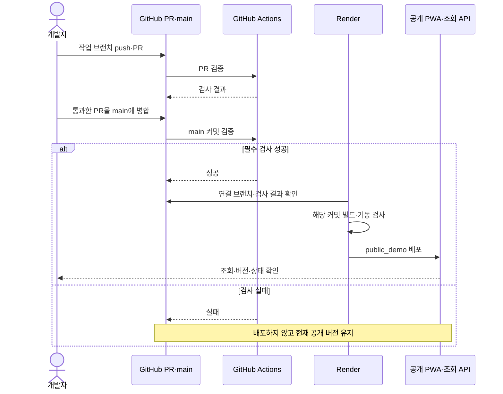

# GitHub 형상관리 및 Render 자동 배포

상태: 기획 확정. 현재 작업 폴더에는 실행 앱·패키지·Git 저장소가 준비되지 않았으며, 원격 저장소 연결·Actions·Render 배포 설정은 아직 수행하지 않았습니다. 아래 실행 파일은 앱 구현 단계에 생성합니다.

최종 시연 산출물은 검토된 심층 리서치 보고서입니다. CI에는 보고서 인용 계약·초안 비공개·Markdown 출력 검사를 포함하고, 배포 후에는 공개 보고서 목록→상세→원문 근거→다운로드를 점검합니다. 보고서 생성 Agent는 로컬에서 실행하며 Render에 배포하지 않습니다.

문서를 수정·검토하는 전문가 에이전트는 개발 작업 방식이며 런타임 전문가 검색·카탈로그 서비스가 아닙니다. 앱은 Crawler 수집 → Part A LLM 온톨로지·KG 구축/검증 → Part B KG 활용 심층 보고서로 구성합니다. KG 추출·검증·정합화·적재는 Part A이며 Part B는 연구 브리프와 `analysis_contract_version`·`ontology_version`·`kg_snapshot_id`를 고정해 탐색·분석·작성·공개를 수행합니다. CI는 질문 유형·온톨로지·KG snapshot·보고서 절·허용 도구·예산/평가 계약의 호환성을 검사합니다.

## 형상관리

- `main`: 검증을 통과한 공개 데모 기준 코드.
- `feat/*`, `fix/*`, `docs/*`: 기능·수정·문서 작업 브랜치.
- PR에 변경 이유·사용자 동작·검증 결과를 기록하고 `main` 병합 전에 확인합니다.
- 가능한 저장소 보호 설정으로 PR과 필수 CI 검사를 요구하고 force push를 제한합니다. 사용 가능한 보호 기능은 저장소 공개 여부와 계정 요금제에서 확인합니다.
- 코드·SQL 마이그레이션·프롬프트·온톨로지 설정·의존성 lock 파일은 Git으로 관리합니다.
- 비밀값·원문 dump·캐시·로컬 실행 결과는 제외합니다. 공개 sample은 배포 가능한 범위의 고정 fixture를 사용합니다.
- `.gitignore`는 이미 추적된 파일의 비밀값을 제거하지 않습니다. 첫 push 전에 tracked 파일·Git 이력·이미지 빌드 입력을 점검하고 노출된 비밀값은 폐기·재발급합니다. `.env.example`만 빈값·공개 예시로 유지하며 `.env copy` 같은 복사본도 제외합니다.
- 배포된 커밋 SHA를 버전 API·운영 로그에 남기고 안정 시연 버전은 태그로 표시합니다.

## 자동 검증

논문·GitHub의 [참조 구현 계획](reference-implementation-plan.md)을 따라 source URL·commit·license/NOTICE·변형 범위·실험 ID를 기록합니다. 연구용 TLogic/MIRAI 등의 원본 의존성 환경은 제품 lock과 분리하고 원본 전체를 Render 이미지에 설치하지 않습니다. 실제 파일을 확인하지 않은 upstream 경로·license는 확정 재사용 대상으로 표시하지 않습니다.

임베딩 변경은 [검색 설계](embedding-retrieval.md)의 기능별 gate로 검증합니다. 일반 PR은 embedding API를 호출하지 않고 고정/대역 벡터로 dimension/profile 검증·snapshot/cutoff 필터·중복 키·금지 FK·원문 chunk offset을 검사합니다. pgvector 통합은 extension이 준비된 격리 PostgreSQL에서 수행하며 remote 모델의 품질/비용 평가는 별도 로컬 실험으로 기록합니다. 공개 이미지에는 embedding 가중치·API 키·자동 재색인을 넣지 않고 EMBEDDING_ENABLED가 비활성인 상태에서 보고서 조회를 확인합니다.

추가 회귀 항목은 KG snapshot 불변·검색 manifest 별도 버전·DB 사전 필터와 사후 소속 검사·source_type별 고유 키·초기화 중 늦은 vector 저장 거부입니다. ANN 결과는 같은 필터의 정확 검색 baseline과 비교합니다.

예정 파일: `.github/workflows/ci.yml`. `pull_request`와 `push`의 `main`에서 실행하고 저장소 읽기 권한으로 시작합니다. 외부 PR에 운영 비밀값을 전달하지 않습니다.

| 검사 | 내용 |
|---|---|
| Python | 고정 Python·uv 환경, lock 기반 설치, Ruff, 핵심 unit·API 계약 검사 |
| Frontend | 고정 Node.js·npm ci, TypeScript 검사, Vitest, Vite PWA production 빌드 |
| 브라우저 | Playwright로 공개 조회·오프라인 변경 차단·관리 라우트 미노출·SPA 경로 확인 |
| 통합 | 격리된 PostgreSQL에서 FK 미생성·논리 참조·PostgresSaver 초기화/복구 검사; 외부 Aura 검증은 별도 절차 |
| 배포 준비 | public_demo의 비밀값 없는 시작과 React 정적 파일·API 경로 분리 확인 |
| 보고서 계약 | brief·analysis_contract_version·ontology_version·kg_snapshot_id 일치 및 snapshot ready 상태, 근거 manifest와 승인 해시, 초안/철회 보고서·타 프로젝트 인용 차단 |
| 최소 권한 | 공개 DB 역할에 INSERT/UPDATE/DELETE/DDL 권한이 없는지 검증하고 public_demo에서 관리자·생성·재생성·삭제·백업·복원 라우트 미등록 확인 |

테스트 실행을 skip하거나 대상 파일 누락을 무시하는 성공 처리는 하지 않습니다. 필요한 검사와 앱 파일이 준비된 시점에 CI를 활성화합니다. CI에서 실뉴스 수집·유료 LLM 호출·운영 데이터 삭제·운영 dump를 실행하지 않습니다.

필수 job을 하나의 최종 `ci-required` 결과로 집계하고 모든 필수 검사 결과가 실제 `success`인지 확인합니다. 취소·누락·skip·실행할 테스트 0건을 성공으로 바꾸지 않습니다. 선택 검사는 필수 검사와 분리하고 main에서도 같은 검증을 실행합니다. Action 버전·실행 도구·이미지를 고정하며 `contents: read`부터 필요한 권한만 부여합니다. 외부 PR 코드를 비밀값이 있는 권한 컨텍스트에서 실행하지 않습니다. 운영 연결이 필요한 실험은 로컬/별도 검증 환경의 기록으로 관리합니다.

## Render 배포

1. GitHub 저장소와 Render Free Web Service를 연결하고 배포 브랜치를 `main`으로 지정합니다.
2. React production 빌드와 Python API를 묶는 Dockerfile을 작성하고 Node.js·Python·의존성을 고정합니다. `.dockerignore`에서 `.env` 및 복사본·dump·백업·data·Git 이력·테스트 결과를 제외합니다.
3. Render 환경은 `APP_ENV=production`, `APP_MODE=public_demo`로 지정합니다. 시작 시 Render의 `PORT`에 바인딩하고 호스트는 `0.0.0.0`을 사용합니다.
4. Supabase 읽기 전용 접속 문자열·Aura 조회용 자격 증명·`PUBLIC_DEMO_PROJECT_ID`를 Render 환경변수에 설정합니다. LLM 키·관리자 토큰·백업 URL·체크포인트 쓰기 URL은 배포하지 않습니다. `.env.example` 전체를 배포 설정으로 복사하지 않습니다.
5. Auto-Deploy를 **After CI Checks Pass**로 설정합니다. 초기 연결에서는 검사 통과 여부와 실제 배포 커밋을 확인합니다.
6. FastAPI는 React 빌드 파일과 `/api`를 같은 origin으로 제공하고 `/api` 오류를 SPA index로 대체하지 않습니다. DB·LLM·Worker·마이그레이션은 서버 시작 때 자동 실행하지 않습니다.
7. 프로세스 상태 확인 `/api/health`와 별도의 의존성 점검을 정의합니다. 시작 검사는 외부 DB 휴면 때문에 끝없이 대기하지 않도록 제한합니다.

Render의 CI 연동은 `neutral`·`skipped`도 통과로 간주할 수 있으므로 필수 CI는 실제 검사를 수행하고 생략되면 실패하도록 설계합니다. 배포 hook은 사용하지 않으며 동일 커밋을 두 경로로 중복 배포하지 않습니다. [자동 배포 공식 문서](https://render.com/docs/deploys#automatic-deploys)

## 공개 조회 경계

Render용 PostgreSQL 역할은 업무 스키마 전체의 원문·초안·실행 로그를 읽는 계정과 분리합니다. 공개 보고서·허용된 기사 근거만 노출하는 검증된 view 또는 제한된 읽기 계층에 필요한 SELECT·USAGE만 부여합니다. `published` 상태와 `PUBLIC_DEMO_PROJECT_ID`를 모든 목록·상세·인용·다운로드 경로에 적용하고 임의 ID로 다른 프로젝트·초안을 요청해도 반환하지 않습니다. 권한 정의·view·인덱스는 마이그레이션으로 관리하며 FK는 생성하지 않습니다.

Aura 자격 증명은 요금제가 지원하는 범위에서 조회 권한으로 제한합니다. 별도 read-only 역할이 제공되지 않는 환경에서는 DB 수준 읽기 전용이 보장된다고 주장하지 않습니다. 공개 API는 매개변수만 받는 고정 읽기 Cypher를 호출하고 사용자 제공 Cypher·SQL·노드 레이블을 실행하지 않습니다. Neo4j의 내부 원문·비공개 Claim을 직접 노출하지 않고 해당 published 보고서의 citation manifest를 PostgreSQL에서 대조합니다.

공개 PWA 빌드에서도 관리자 페이지와 내부 프롬프트·개발 fixture·원문 전체를 제외합니다. 백엔드 미등록이 실제 권한 경계이며 메뉴 숨김은 보조입니다. 최종 이미지의 파일 목록·frontend bundle·source map·환경변수를 검사하여 서버 키·dump·`.env`·쓰기 URI가 없는지 확인합니다. public_demo 서버는 조회에 필요한 의존성만 설치하고 Worker·모델 초기화가 import 시 실행되지 않아야 합니다.

## 시퀀스

빌드 실패·시작 실패는 Render 배포 이력에서 확인합니다. 배포 후에는 PWA 시작·기사 검색·사건 근거 조회·관리 API 미노출·커밋 버전을 확인합니다. 빌드·기동 성공과 실제 조회 정상 여부를 구분하여 기록합니다.

배포 후 smoke 검증은 `/api/health`의 프로세스 상태, 배포 SHA, 공개 보고서 상세와 근거 인용, 같은 버전 Markdown, 초안/다른 프로젝트 ID 비노출, POST 관리 경로 미등록, `/api` 오류가 HTML fallback이 되지 않는지를 확인합니다. 외부 DB 장애는 빈 정상 결과가 아니라 제한된 오류 응답으로 표시합니다. 무료 인스턴스 기동 지연을 고려해 횟수·시간이 제한된 재시도를 적용하고 무한 ping으로 휴면 정책을 우회하지 않습니다. 이 검증을 자동화할 때 CI 완료와 Render의 실제 배포 완료를 구분하고, 신뢰된 main의 별도 수동/예약 검증에서 배포 SHA까지 대조합니다.

## 복구·데이터 변경

문제가 생기면 Git에서 수정 또는 revert PR을 만들어 CI를 통과시킨 후 재배포합니다. 급한 시연 복구는 Render에서 사용 가능한 이전 배포를 선택하는 수동 절차를 사용합니다. 데이터베이스는 코드 rollback과 함께 자동 복구되지 않습니다.

스키마 변경은 로컬에서 추가 dump를 보관하고 별도 마이그레이션 절차로 실행합니다. 기존 공개 앱과 호환되는 추가 변경을 우선 적용하고 새 앱을 배포한 뒤 사용하지 않는 구조를 정리합니다. 초기화·삭제·재생성·원문 수집·정기 백업은 로컬 관리자와 Worker·작업 스케줄러에서 수행합니다.

코드·analysis contract·온톨로지·prompt 버전을 보고서와 함께 기록합니다. 코드 rollback 시 과거 체크포인트나 새 계약이 자동 호환된다고 가정하지 않고 별도 검사합니다. 데이터 복원 중에는 공개 조회를 유지보수 상태로 차단하고, Supabase와 Aura·공개 보고서 포인터의 정합성을 검증한 뒤 정상화합니다. 공개 상태 전환은 여러 외부 저장소의 분산 트랜잭션으로 보장된다고 표현하지 않습니다.

Part A 재적재·초기화·KG 재구축은 로컬 관리자 전용 데이터 작업이며 코드 자동 배포와 분리합니다. 변경 전 보고서가 참조하는 kg_snapshot_id와 원문·주장 manifest를 고정하고, 삭제 범위의 보고서는 철회/보류합니다. 새 KG가 생성돼도 기존 공개 보고서의 참조 snapshot을 조용히 바꾸지 않습니다. Part B 보고서 작업이 KG를 수정·재적재하는 경로는 CI에서 차단합니다.

완료 기준: PR 실패 시 병합 제한, main 검사 실패 시 배포 중단, 통과 커밋 자동 배포, 비밀값/덤프 미포함, 공개 쓰기 차단, SPA·PWA 동작, 배포 SHA 확인, 이전 코드 복구 시연입니다.
