# NewsContext 시퀀스 다이어그램

기획 단계의 목표 호출 흐름입니다. 함수 이름과 API는 구현 계약 초안이며, 대단위 흐름에서 하위 함수 호출로 내려가도록 구성했습니다. Mermaid를 지원하는 Markdown 뷰어에서 확인할 수 있습니다.

최종 산출물은 Part B의 **근거 기반 심층 리서치 보고서**입니다. 아래 기존 KG 생성·탐색 시퀀스는 보고서 근거를 공급하며 보고서 생성·검토·공개 흐름을 13번에 추가했습니다. 공개 사용자는 보고서를 조회하고 생성·재작성은 로컬 관리자와 Worker가 수행합니다.

> **읽는 법(2026-11-17 정리):** 로컬 본체 우선 결정(2026-11-13, [corpus-feasibility §8](corpus-feasibility.md))에 따라 MVP의 정본은 **로컬 PostgreSQL**, 그래프도 **같은 로컬 PostgreSQL의 그래프 테이블**입니다([README 저장소 기준](../README.md), 2026-11-17 Neo4j 제외 결정). 다이어그램 참여자도 이 기준으로 바꿨습니다. `로컬 PostgreSQL`과 `로컬 PostgreSQL 그래프 테이블`이 따로 그려진 곳은 같은 DB의 다른 테이블이며, 그래프 쓰기와 작업 상태 기록은 한 트랜잭션입니다. `Supabase 공개 사본`과 `Render`는 공개 데모(향후) 구성이며, 공개용 export 단계가 로컬 정본에서 선별 적재합니다.

공개 데모(향후)도 그래프를 Supabase PostgreSQL의 그래프 테이블에 두며 AuraDB는 쓰지 않습니다. Python 서버·Worker·초기화 CLI만 DB에 접속하고 PWA는 FastAPI를 통해 접근합니다. DB 초기화는 그래프 테이블 마이그레이션(고유 제약·인덱스)입니다. 개발 삭제·복구는 프로젝트·버전 범위로 한정합니다. `kg_snapshot_id`는 물리 DB 복사본이 아니라 PostgreSQL의 불변 corpus/claim/evidence/batch manifest와 snapshot membership 테이블을 가리킵니다.

아래 추출/정합화는 [EDC·KGGen 등 Part A 참조](reference-implementation-plan.md), 보고서 경로·부분 분석/종합은 ToG·GraphRAG, cutoff 도구는 MIRAI를 참고한 프로젝트용 변형입니다. 필요한 embedding 검색은 별도 로컬 adapter·PostgreSQL pgvector로 수행하며 근거·snapshot 검증을 대체하지 않습니다.

배포 모드는 로컬 관리(`local_admin`, MVP)와 공개 조회 데모(`public_demo`, 향후)로 나눕니다. 아래 수집·Part A·Part B·관리·초기화 시퀀스는 로컬 관리자 API와 로컬 Worker에서만 실행합니다. 공개 데모의 Render에서는 PWA 정적 파일과 읽기 전용 FastAPI만 제공하고 생성·변경 API를 등록하지 않습니다. 모든 Checkpointer는 로컬 PostgreSQL의 `langgraph` 스키마를 가리킵니다.

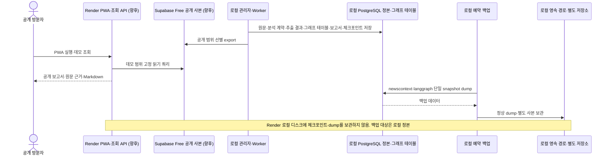

## 1. 대단위: 뉴스 수집부터 심층 보고서 공개까지

업무 단계는 **Crawler → Part A → Part B**입니다. Part A는 LLM 온톨로지와 분석 계약을 승인하고 기사 추출·근거 검증·정합화·그래프 적재를 수행하여 ready KG snapshot을 발행합니다. Part B는 analysis_contract_version·ontology_version·kg_snapshot_id와 보고서 brief를 입력으로 받습니다. 온톨로지 계약 승인, 추출 주장 검토, 최종 보고서 공개는 별도 결정입니다.

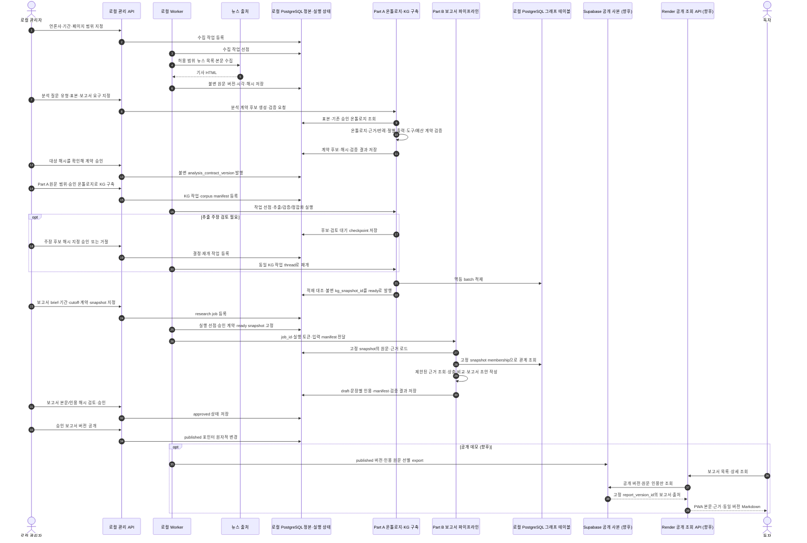

지원하지 않는 brief·미승인 계약·검증 실패·초안 상태는 공개로 진행하지 않습니다. 자료가 부족하면 분석 한계를 명시하거나 검토로 보류합니다. 이미 승인된 계약과 ready KG snapshot이 질문·기간을 지원하면 Part A를 반복하지 않고 Part B를 새 brief로 실행할 수 있습니다. Part A는 온톨로지·KG를 구축하는 단계이며 런타임 전문가 검색·팀 구성 기능을 뜻하지 않습니다.

### Part A 하위: 온톨로지·분석 계약 설계·승인

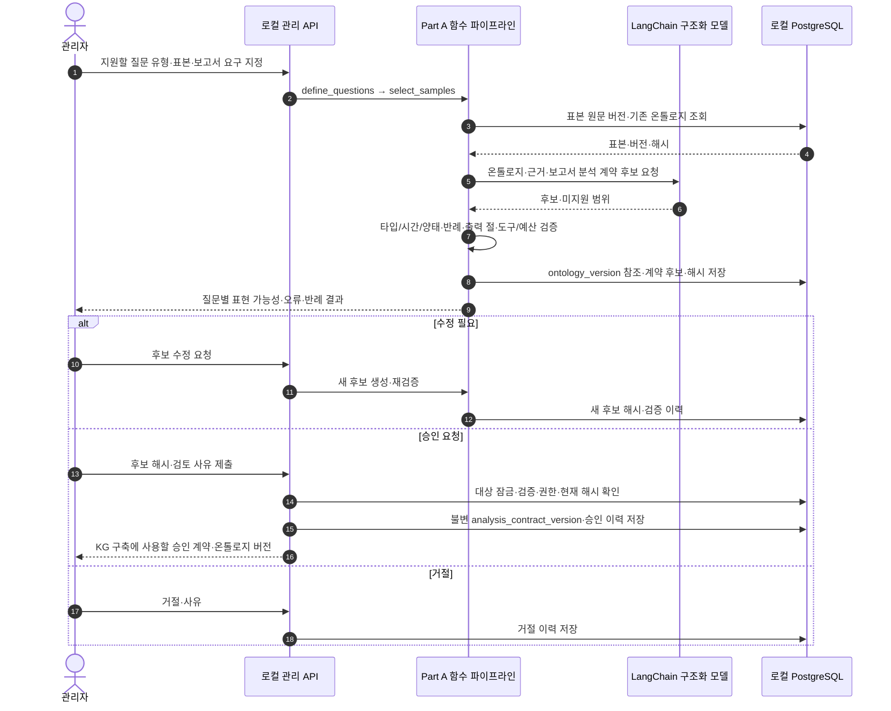

Part A KG 구축에서 계약 밖 타입·관계가 발견되거나 Part B에서 지원하지 않는 질문이 발견되면 Part A 변경 후보로 보냅니다. 변경은 새 계약·KG snapshot으로 발행하며 기존 보고서 입력은 바꾸지 않습니다. 전문 에이전트의 기획 문서 검토와 제품의 분석 계약 생성은 별개입니다.

## 2. 하위: DB 초기화와 스키마 변경

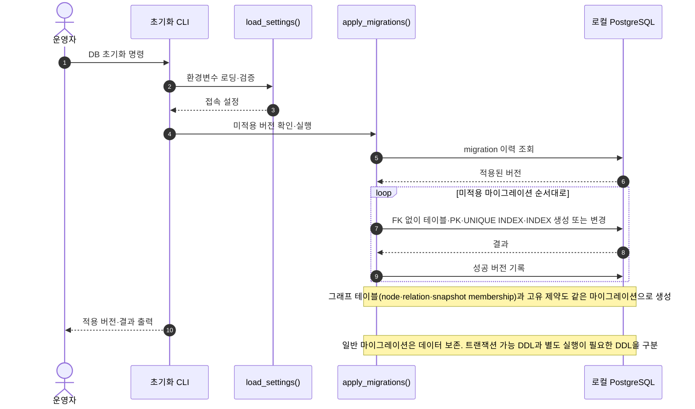

## 3. 하위: 뉴스 수집 함수 파이프라인

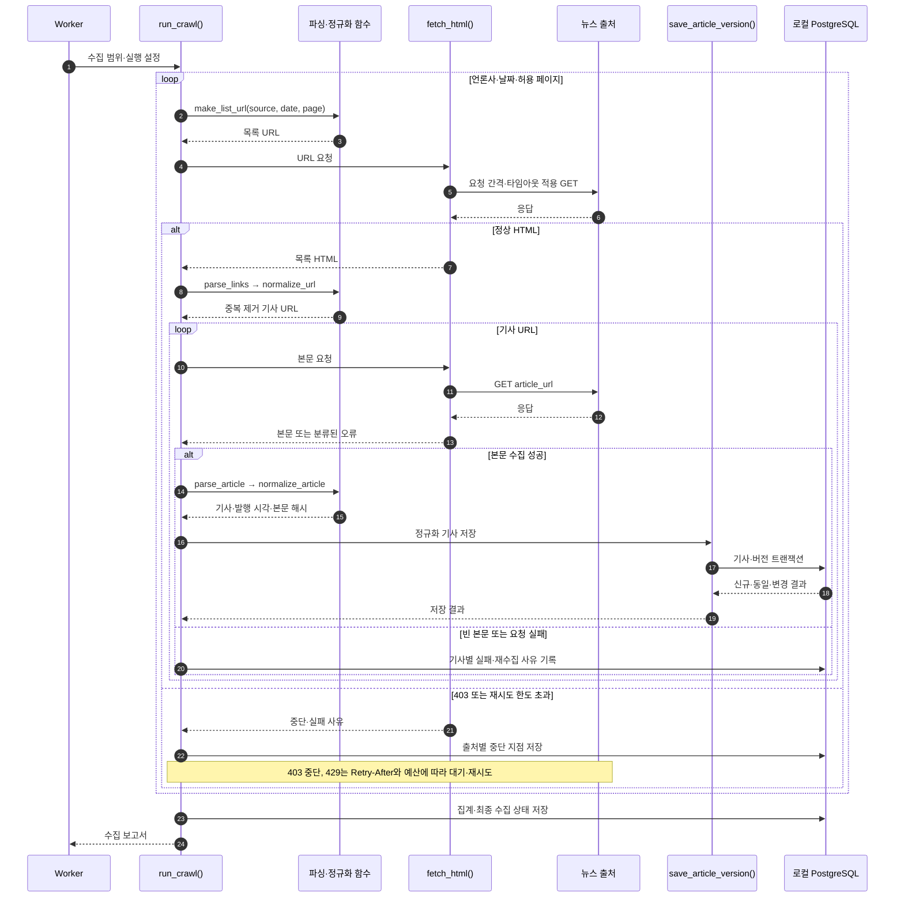

목록이 비었거나 이전 페이지와 같은 URL 집합이 반복되면 페이지 순회를 종료합니다. 한 기사 실패는 기록 후 다음 기사로 진행하고, 출처 단위 접근 제한은 해당 출처 수집을 중단합니다.

## 4. 하위: 중복 검사와 기사 정정 버전 저장

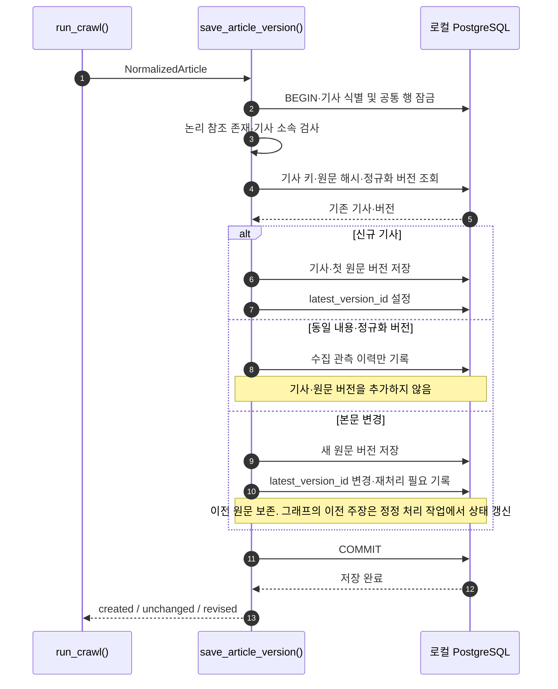

PostgreSQL(로컬 정본)에는 FK를 생성하지 않습니다. 참조 검증과 저장은 같은 연결·트랜잭션에서 실행하고, 부모 삭제 경로도 동일한 행 잠금 규칙을 적용합니다. 신규 기사는 기사 행을 먼저 만든 뒤 원문 버전과 최신 버전 참조를 저장합니다. 고유 인덱스 충돌은 다른 작업의 선행 저장 여부를 다시 조회해 판정합니다. 무결성 오류를 모두 중복으로 처리하지 않습니다. 새 원문 처리 전에는 기존 그래프 결과가 이전 버전 기준임을 표시합니다.

## 5. 하위: Part A 구조화 추출·검증·정합화

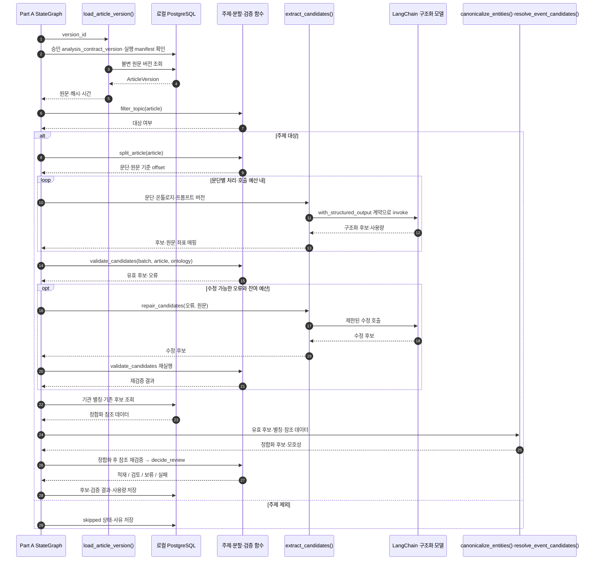

원문 인용은 문단의 로컬 offset을 원문 버전 기준 offset으로 바꾼 후 검증합니다. 수정 호출은 루프 정책의 한 회를 표현한 것이며 전체 횟수·토큰·시간 제한을 넘기지 않습니다. 미검증 후보는 적재 분기로 전달하지 않습니다.

이 시퀀스는 Part A의 KG 근거 생성 하위 흐름입니다. 현재 기사 최신값 대신 실행 manifest에 고정된 article_version_id와 계약 버전을 사용합니다. 추출 완료가 보고서 공개 완료를 의미하지 않습니다.

## 6. 하위: Part A 추출 주장 검토와 LangGraph 재개

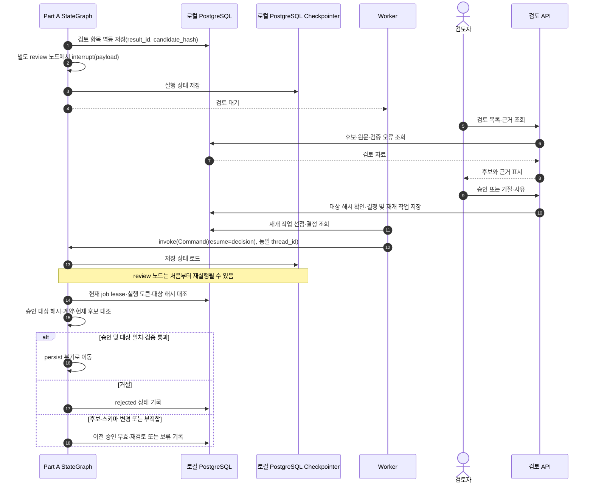

승인은 스키마·근거 검증을 우회하지 않습니다. 검토 항목 생성과 대기 노드를 분리하여 재개 시 불필요한 외부 쓰기를 줄이고, 검토 항목 생성 자체에도 고유 키를 둡니다.

같은 thread를 여러 Worker가 동시에 재개하지 못하도록 실행 lease와 토큰을 확인합니다. 오래된 Worker의 늦은 결과 저장은 토큰 불일치로 거부하며, 후보 승인과 최종 보고서 승인/공개는 서로 대체하지 않습니다.

## 7. 하위: Part A 그래프 적재·snapshot 발행·복구

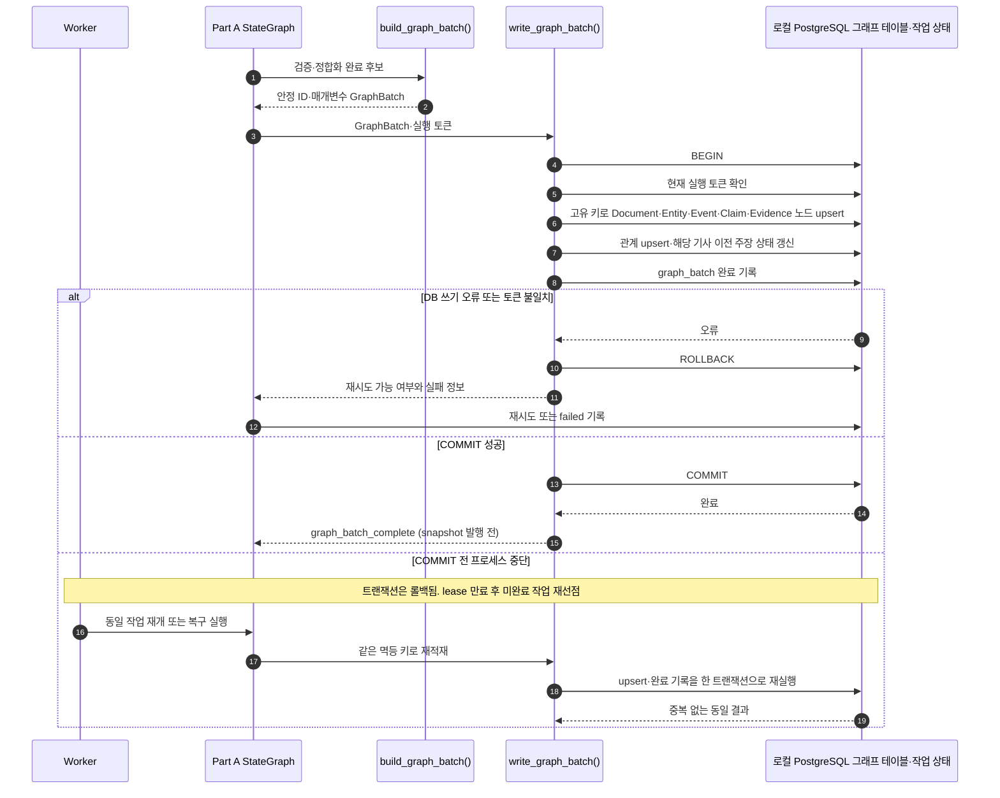

체크포인트 복구 위치에 따라 적재 노드가 생략되거나 재실행될 수 있습니다. 두 경우 모두 외부 저장 결과가 동일하도록 설계합니다. 그래프 테이블 쓰기와 작업 완료 표시는 같은 PostgreSQL 트랜잭션으로 묶고, 재실행에 대비해 멱등 쓰기를 유지합니다. 정정으로 교체하는 주장은 해당 원문 계보에 한정하고, 다른 기사의 유효한 근거를 제거하지 않습니다.

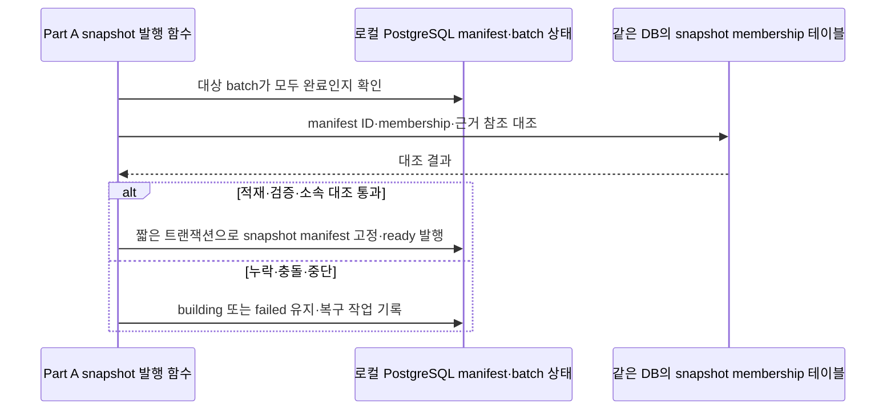

Part B는 ready snapshot만 읽습니다. 과거 snapshot을 사용하는 보고서가 존재하면 해당 membership과 근거 버전을 보존합니다. 정정 시 기존 ready manifest를 수정하지 않고 새 snapshot을 만듭니다. snapshot 범위 밖 최신 관계는 공통 조회 함수가 제외합니다.

## 8. 하위: 검색·타임라인·원문 근거 조회

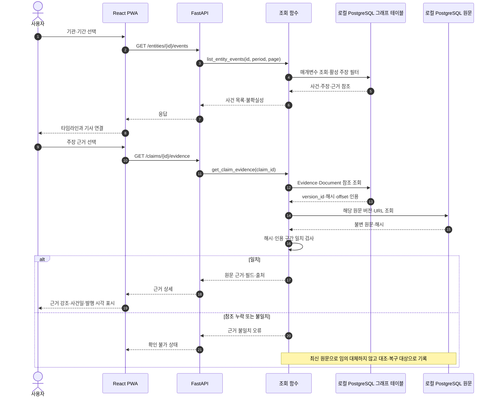

## 9. 하위: 관리자 조작·인증·작업 등록

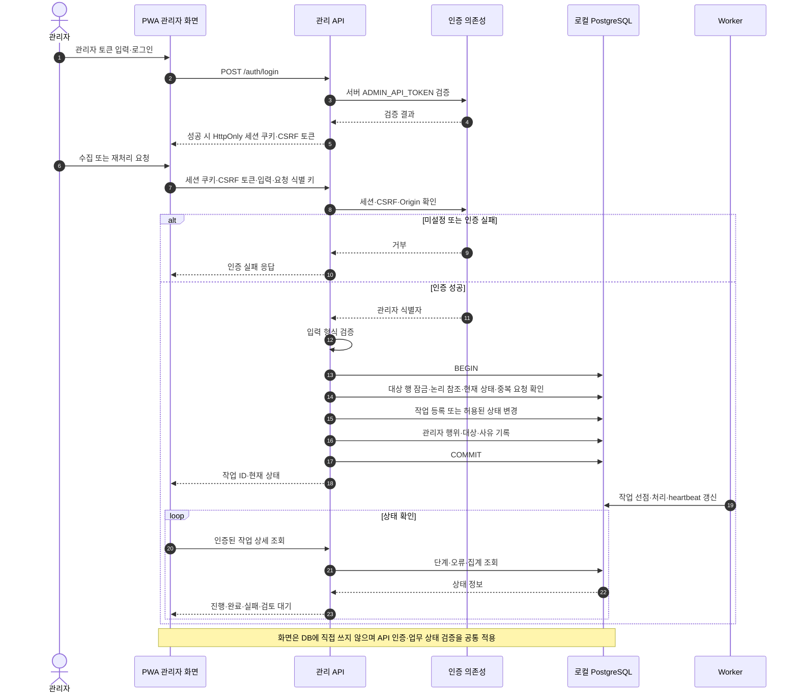

검토 승인·거절은 6번 시퀀스로 연결됩니다. 중지 요청은 작업에 플래그를 기록하고 Worker가 안전한 처리 경계에서 확인합니다. 설정 조회는 비밀값을 반환하지 않습니다.

## 10. 하위: 개발용 Part A 삭제 후 재작업

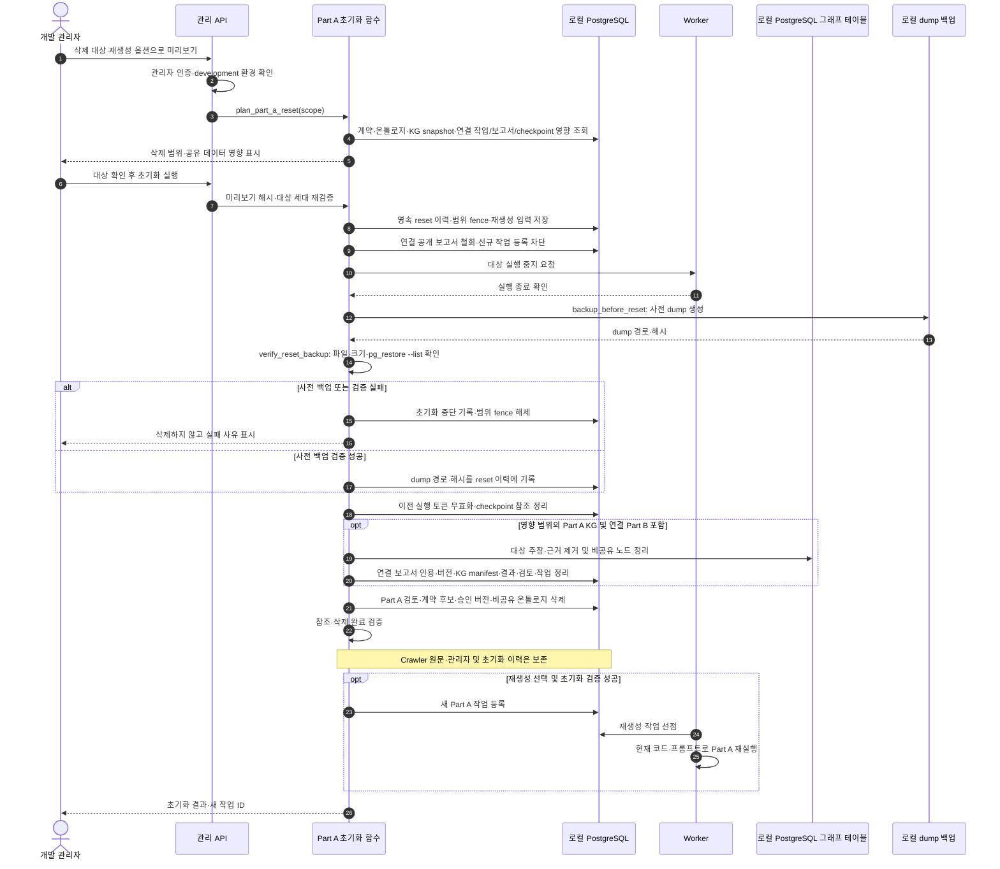

삭제는 사전 dump 검증이 성공한 뒤에만 시작합니다([백업·복원](backup-restore.md)). 삭제 도중 실패하면 초기화 단계 이력으로 재개하고 재생성을 보류합니다. 연결 Part B가 있는데 함께 정리하지 않는 요청은 거부합니다. 초기화 범위의 새 작업 등록은 잠금 해제 전까지 제한합니다.

범위 fence는 장시간 row lock과 다릅니다. Worker 종료·그래프 정리를 기다리는 동안 DB 트랜잭션을 열어두지 않습니다. 단계별로 짧게 잠금·상태를 확인하며 공개 포인터를 먼저 철회하고 삭제된 근거를 참조하는 보고서가 노출되지 않게 합니다. checkpoint는 지원되는 삭제 절차로 정리하고, 초기화 완료 전 늦게 도착한 작업 쓰기는 실행 토큰과 reset 세대로 거부합니다. 원문·감사 기록과 다른 보고서가 참조하는 공유 근거는 보존합니다.

## 11. 하위: PWA 시작·오프라인·업데이트

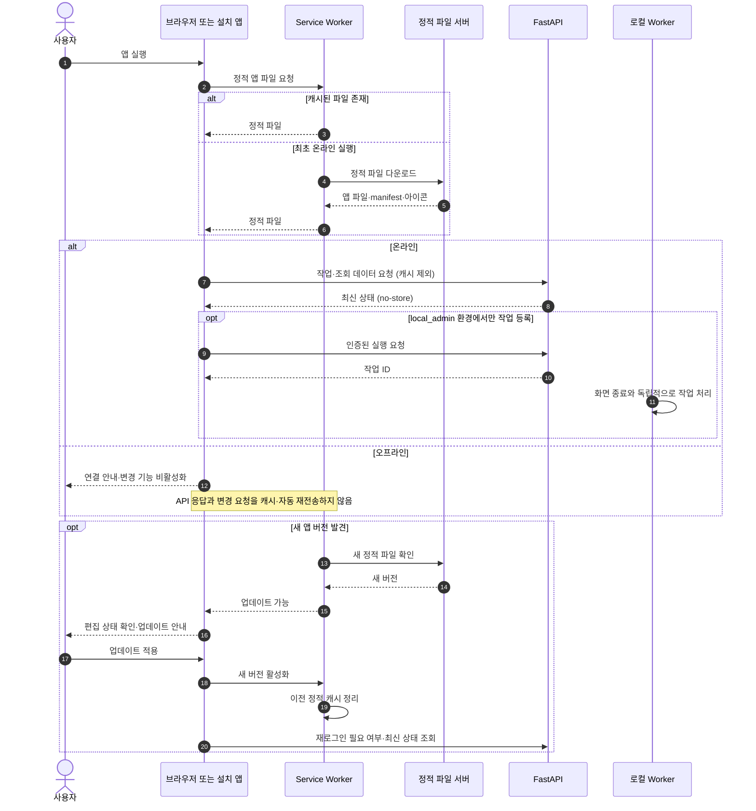

처음부터 오프라인이고 앱 파일도 캐시되지 않은 경우에는 앱을 시작할 수 없습니다. 설치·일반 브라우저 실행 모두 같은 인증·캐시 정책을 적용합니다.

## 12. 하위: PostgreSQL 정본 정기 dump·별도 보관

> 백업 대상은 로컬 PostgreSQL 정본(그래프 테이블 포함)입니다. Supabase는 공개 데모(향후) export 대상이며 백업하지 않습니다([backup-restore](backup-restore.md)).

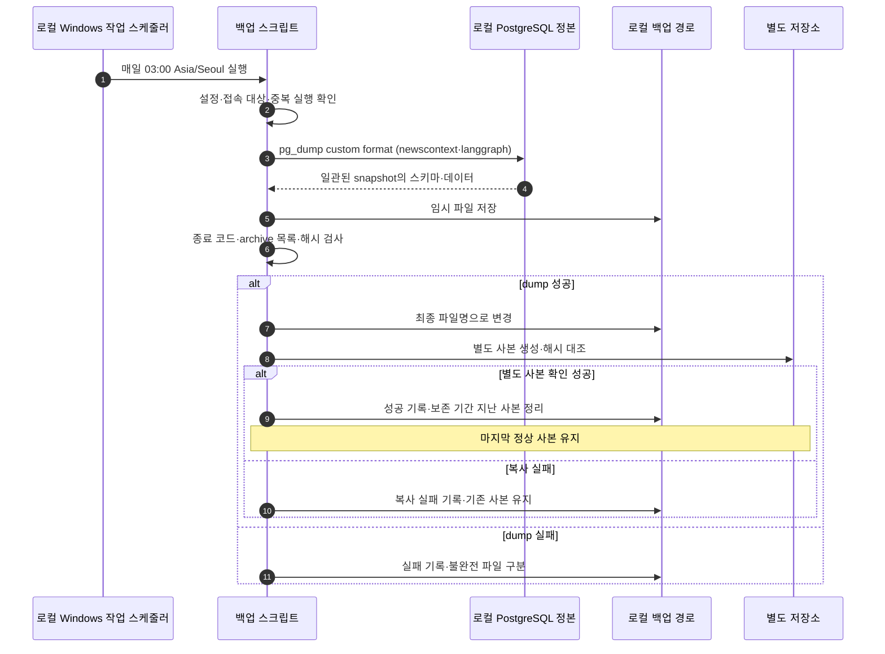

월 1회 격리 DB에 실제 복원해 행 수·인덱스·논리 참조와 화면 조회를 확인합니다. 클라우드 백업과 별도로 보존하는 dump이며 실제 스케줄은 후속 구현 시 등록합니다.

## 13. 하위: Part B 심층 리서치 보고서 생성·공개

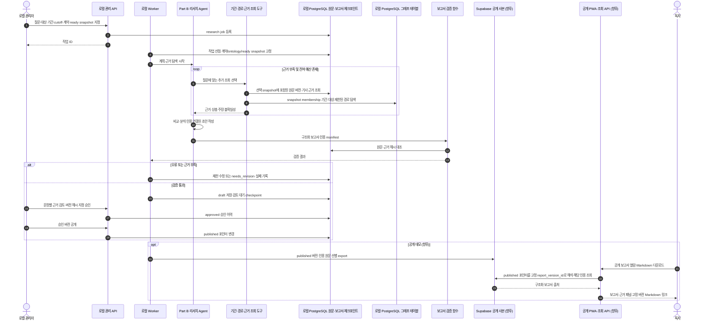

초안은 공개되지 않으며 배포 서버에서 LLM을 호출하지 않습니다. 재작성은 새 버전으로 처리하고 공개된 버전을 직접 덮어쓰지 않습니다. 결과가 불충분하면 한계를 표시하거나 공개를 보류합니다.

Part B는 KG를 추출·갱신하지 않습니다. 선택 snapshot에 근거가 부족하면 한계를 남기거나 별도 Part A 구축을 요청하고 그 결과는 새 보고서 작업에서 사용합니다. 독자가 조회한 `report_version_id`를 Markdown 링크에도 지정하여 조회 중 공개 포인터가 바뀌어도 본문·인용·다운로드가 같은 버전을 가리키게 합니다.

## 14. 하위: 조건부 임베딩 후보 검색

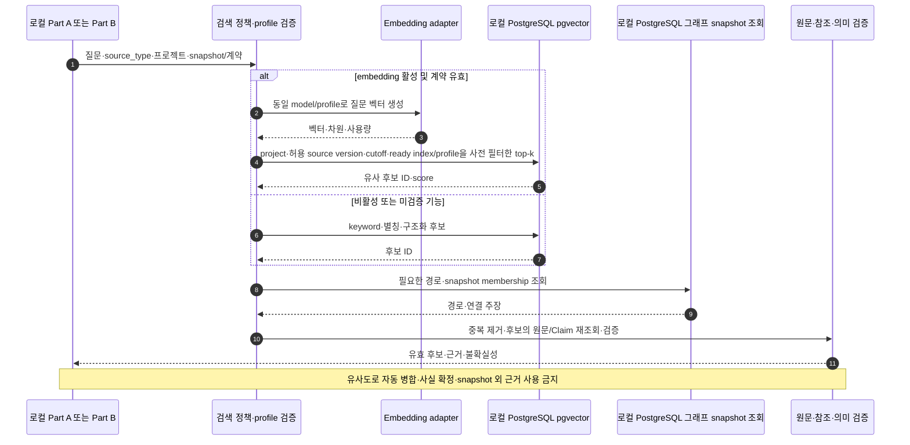

Part A 후보 검색은 승인 온톨로지/기사 범위로, Part B는 ready snapshot과 cutoff로 제한합니다. 원본 GraphRAG/ToG/EDC의 vector 도입 여부와 제품 adapter는 [소스 감사](source-audit.md)에서 구분합니다.

검색 index manifest는 KG snapshot과 별도로 생성하고 Part B 실행에 profile과 함께 고정합니다. 재색인·모델 변경은 기존 KG/보고서 입력을 덮어쓰지 않습니다. source_type을 포함한 고유 키와 부모 검증·초기화 fencing으로 vector의 고아 참조·늦은 쓰기를 막습니다.

## 15. 구현 계획과 연결

| 다이어그램 | 대응 기능 | 핵심 검증 |
|---|---|---|
| 1 대단위 | F01~F13 | Crawler→A KG snapshot→B 보고서→공개 근거 연결 |
| 2 DB 초기화 | F01~F02 | 재실행·마이그레이션 실패 시 데이터 보존 |
| 3 수집 | F03 | 페이지 종료·요청 제한·기사별 실패 격리 |
| 4 원문 버전 | F04 | 동일 입력 불변·정정 이력 보존 |
| 5 추출·검증 | F05~F07 | 출력 계약·근거·단위·불확실성 처리 |
| 6 검토·재개 | F08 | 승인 대상 일치·거절 미적재·재시작 복구 |
| 7 적재·복구 | F09 | Part A 부분 실패·멱등성·ready snapshot 대조 |
| 8 조회 | F10~F11 | 정확한 원문 버전·인용 추적 |
| 9 관리자 | F10~F11 | 인증·허용 상태 변경·중복 방지·감사 기록 |
| 10 개발 초기화 | F05·F08~F11 | 사전 dump 검증 실패 시 삭제 중단·승인 버전 삭제·연결 결과 정리·원문 보존·재생성 |
| 11 PWA | F11~F12 | 설치·오프라인 변경 차단·API 비캐시·업데이트·재접속 |
| 12 dump 백업 | F12 | 성공 dump·별도 사본·보존·격리 복원 검증 |
| 13 리서치 보고서 | F13·F10~F12 | 문장별 인용·상충·한계·검토·공개·버전별 다운로드 |
| 14 임베딩 후보 | F14·F07·F13 | profile·차원·snapshot 필터·후보 검색 품질·의미 재검증 |

공식 API 근거: [LangChain 모델](https://docs.langchain.com/oss/python/langchain/models), [LangGraph Graph API](https://docs.langchain.com/oss/python/langgraph/graph-api), [interrupt와 재개](https://docs.langchain.com/oss/python/langgraph/interrupts). 실제 라이브러리 통합 검증과 구현은 후속 개발 단계에서 수행합니다.
